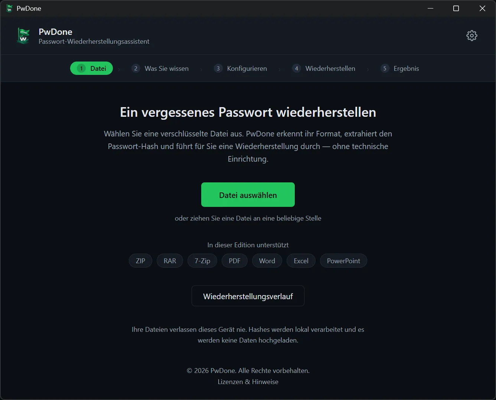
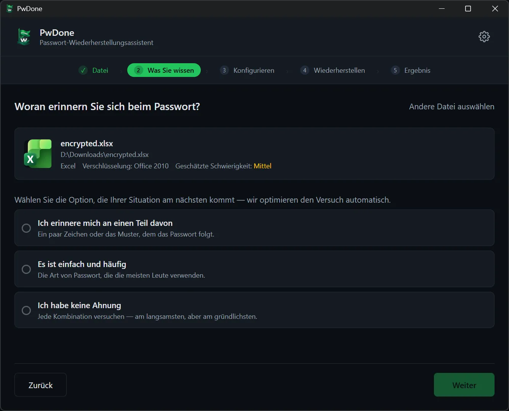
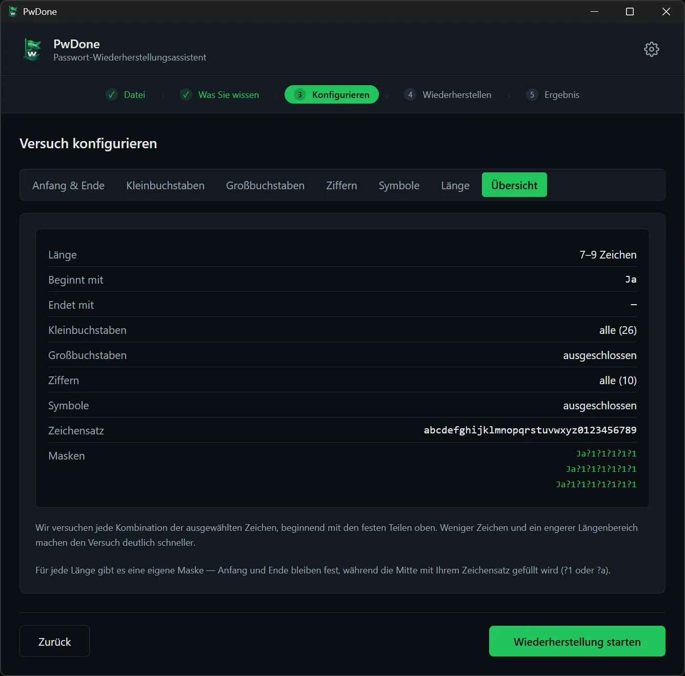
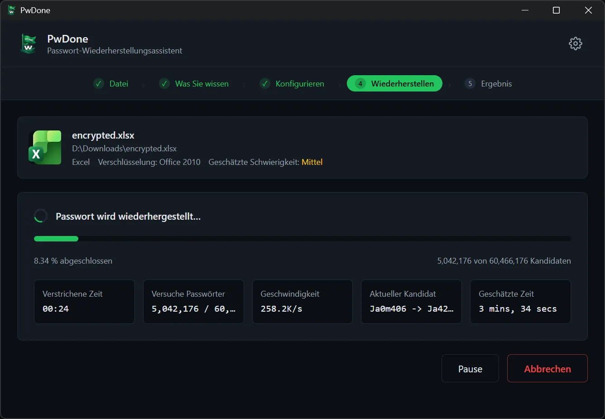
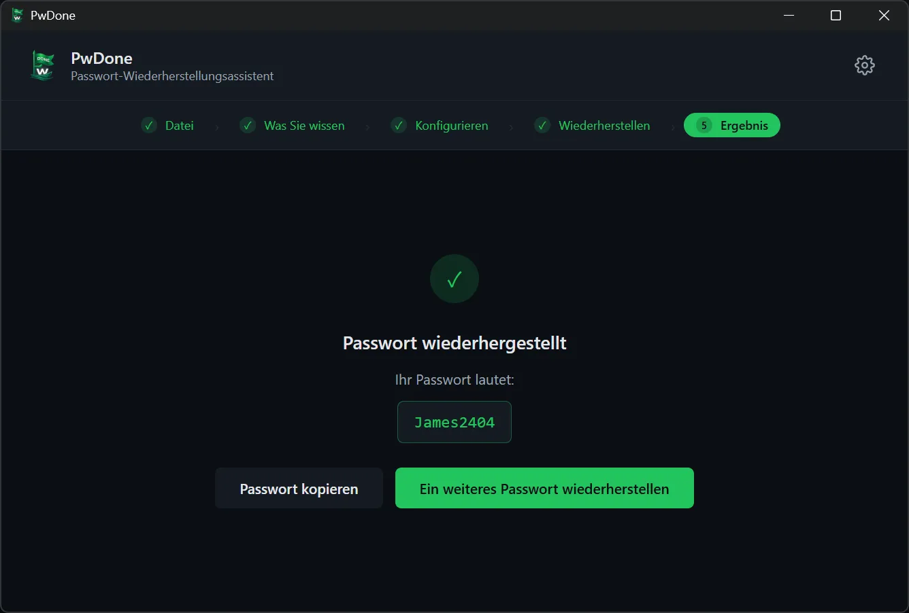

# PwDone

**Lokale Passwortwiederherstellung für deine eigenen verschlüsselten Dateien.**

[English](README.md) · [简体中文](README.zh.md) · [繁體中文](README.zh-Hant.md) · [日本語](README.ja.md) · [한국어](README.ko.md) · **Deutsch** · [Español](README.es.md) · [Français](README.fr.md) · [Italiano](README.it.md) · [Nederlands](README.nl.md) · [Polski](README.pl.md) · [Português](README.pt.md)

PwDone hilft dir, wieder Zugriff auf deine eigenen passwortgeschützten ZIP-, RAR-,
7z-, PDF-, Word-, Excel- und PowerPoint-Dateien zu bekommen. Alles läuft auf deinem
Gerät: Dateien, Hashes und wiederhergestellte Passwörter verlassen deinen Computer
nie.

[Download](https://pwdone.com/download) · [Dokumentation](https://pwdone.com/docs) · [Preise](https://pwdone.com/pricing) · [Vergleich](https://pwdone.com/alternatives) · [Pressemappe](https://pwdone.com/press)

## Ablauf

**1. Datei** — Verschlüsselte Datei auswählen; PwDone erkennt das Format und extrahiert den Hash lokal.

**2. Was Sie wissen** — Angeben, was Sie über das Passwort wissen: ein Teil, ein gängiges Passwort oder nichts.

**3. Konfigurieren** — Länge, Zeichen oder die bekannten Teile festlegen.

**4. Wiederherstellen** — Fortschritt, Geschwindigkeit und aktuellen Kandidaten verfolgen; jederzeit pausieren oder fortsetzen.

**5. Ergebnis** — Das gefundene Passwort kopieren oder eine andere Methode versuchen.

## Funktionen

- Stellt Passwörter für deine eigenen ZIP-, RAR-, 7z-, PDF-, Word-, Excel- und PowerPoint-Dateien wieder her.
- Erkennt das Dateiformat automatisch und extrahiert den Hash lokal.
- Integriert Hashcat (GPU) und John the Ripper (CPU) – ohne Kommandozeile.
- Alles läuft lokal; Dateien, Hashes und Passwörter werden nie hochgeladen.
- Speichert den Verlauf lokal, damit erneute Versuche sofort beantwortet werden.

## Unterstützte Formate

| Format | Endungen | Edition |
| --- | --- | --- |
| ZIP | `.zip` | Archives |
| RAR | `.rar` | Archives |
| 7z | `.7z` | Archives |
| PDF | `.pdf` | PDF |
| Word | `.doc`, `.docx` | Office |
| Excel | `.xls`, `.xlsx` | Office |
| PowerPoint | `.ppt`, `.pptx` | Office |

## Datenschutz

- 100 % lokale Verarbeitung.
- Kein Konto erforderlich.
- Keine Telemetrie und kein Nutzungstracking in der App.
- Der Wiederherstellungsverlauf bleibt lokal und ist jederzeit löschbar.

## Download

- **Windows** 10/11 (64 Bit)
- **macOS** 14+ (Apple Silicon)

Installer und SHA256-Prüfsummen: <https://pwdone.com/download>

> Wenn Windows SmartScreen eine Warnung anzeigt, findest du auf der Download-Seite
> eine kurze Anleitung („Weitere Informationen“ → „Trotzdem ausführen“).

Vollständige Details in der [englischen README](README.md).
