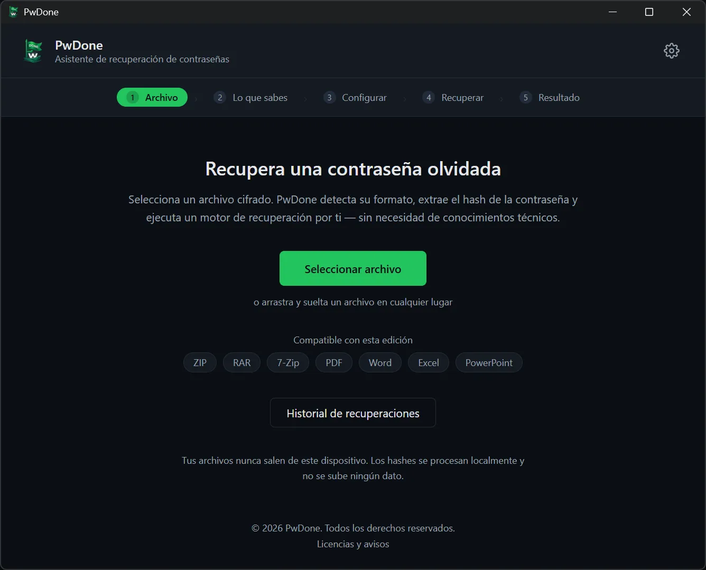
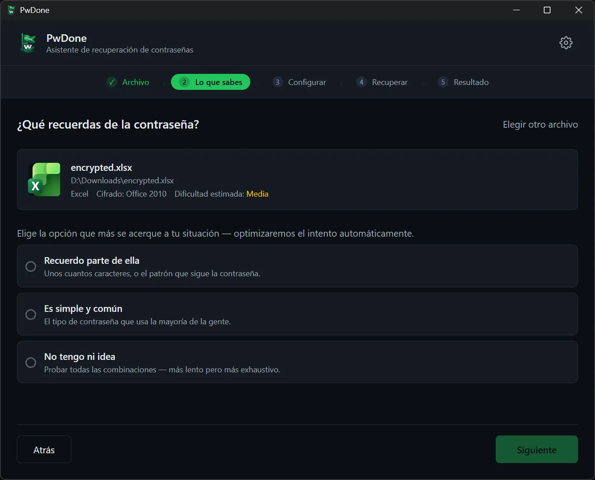
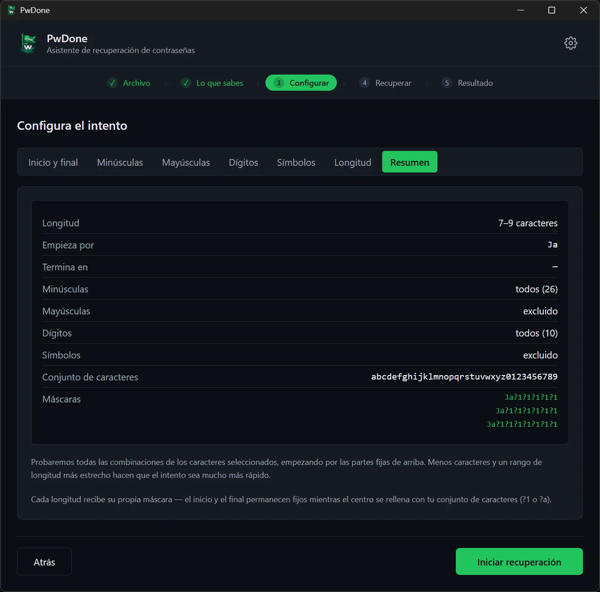
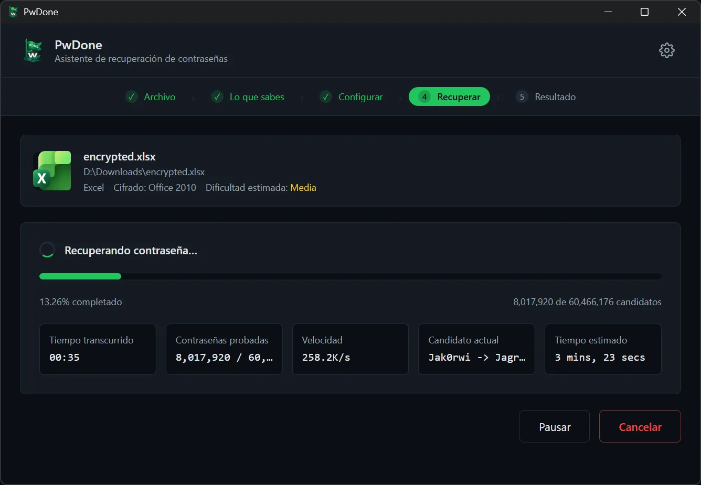
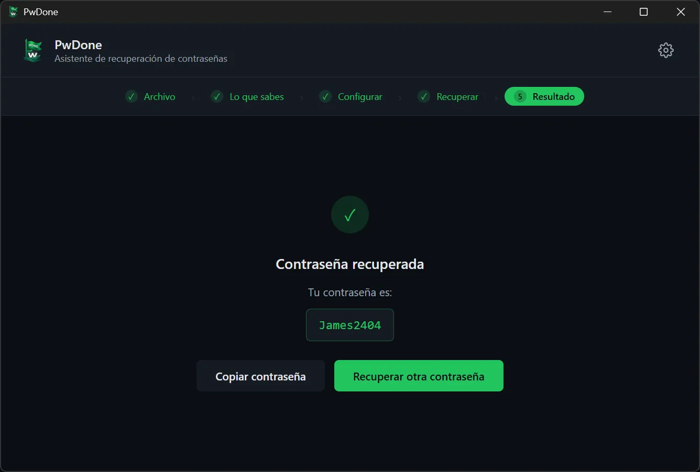

# PwDone

**Recuperación local de contraseñas para tus propios archivos cifrados.**

[English](README.md) · [简体中文](README.zh.md) · [繁體中文](README.zh-Hant.md) · [日本語](README.ja.md) · [한국어](README.ko.md) · [Deutsch](README.de.md) · **Español** · [Français](README.fr.md) · [Italiano](README.it.md) · [Nederlands](README.nl.md) · [Polski](README.pl.md) · [Português](README.pt.md)

PwDone te ayuda a recuperar el acceso a tus propios archivos ZIP, RAR, 7z, PDF,
Word, Excel y PowerPoint protegidos con contraseña. Todo se ejecuta en tu
dispositivo: los archivos, los hashes y las contraseñas recuperadas nunca salen
de tu ordenador.

[Descargar](https://pwdone.com/download) · [Documentación](https://pwdone.com/docs) · [Precios](https://pwdone.com/pricing) · [Comparativa](https://pwdone.com/alternatives) · [Kit de prensa](https://pwdone.com/press)

## Flujo de trabajo

**1. Archivo** — Selecciona un archivo cifrado; PwDone detecta el formato y extrae el hash localmente.

**2. Lo que sabes** — Indica lo que recuerdas de la contraseña: una parte, una contraseña común o nada.

**3. Configurar** — Define la longitud, los caracteres o las partes que recuerdas.

**4. Recuperar** — Sigue el progreso, la velocidad y el candidato actual; pausa o reanuda cuando quieras.

**5. Resultado** — Copia la contraseña recuperada o prueba otro método.

## Funciones

- Recupera contraseñas de tus propios archivos ZIP, RAR, 7z, PDF, Word, Excel y PowerPoint.
- Detecta el formato y extrae el hash localmente.
- Incluye Hashcat (GPU) y John the Ripper (CPU), sin línea de comandos.
- Todo es local; los archivos, hashes y contraseñas nunca se suben.
- Guarda el historial local para que los reintentos sean instantáneos.

## Formatos compatibles

| Formato | Extensiones | Edición |
| --- | --- | --- |
| ZIP | `.zip` | Archives |
| RAR | `.rar` | Archives |
| 7z | `.7z` | Archives |
| PDF | `.pdf` | PDF |
| Word | `.doc`, `.docx` | Office |
| Excel | `.xls`, `.xlsx` | Office |
| PowerPoint | `.ppt`, `.pptx` | Office |

## Privacidad

- Procesamiento 100 % local.
- No requiere cuenta.
- Sin telemetría ni seguimiento de uso en la app.
- El historial de recuperación es local y se puede borrar en cualquier momento.

## Descarga

- **Windows** 10/11 (64 bits)
- **macOS** 14+ (Apple Silicon)

Instaladores y sumas SHA256: <https://pwdone.com/download>

> Si Windows SmartScreen muestra una advertencia, consulta la guía de la página
> de descarga («Más información» → «Ejecutar de todos modos»).

Detalles completos en el [README en inglés](README.md).
