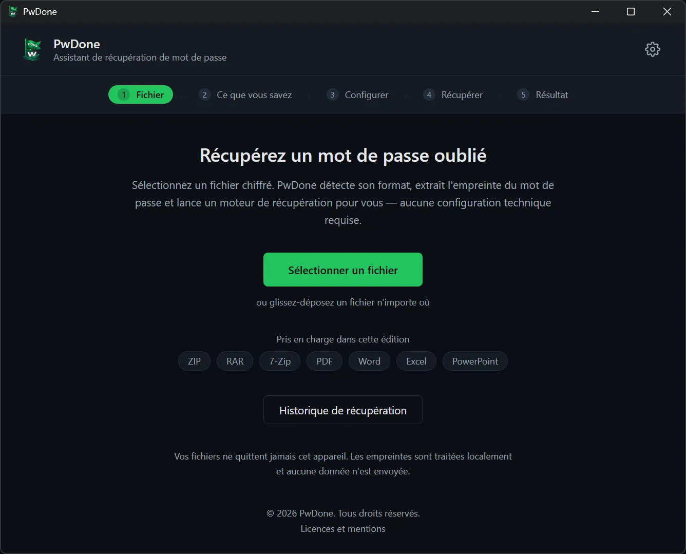
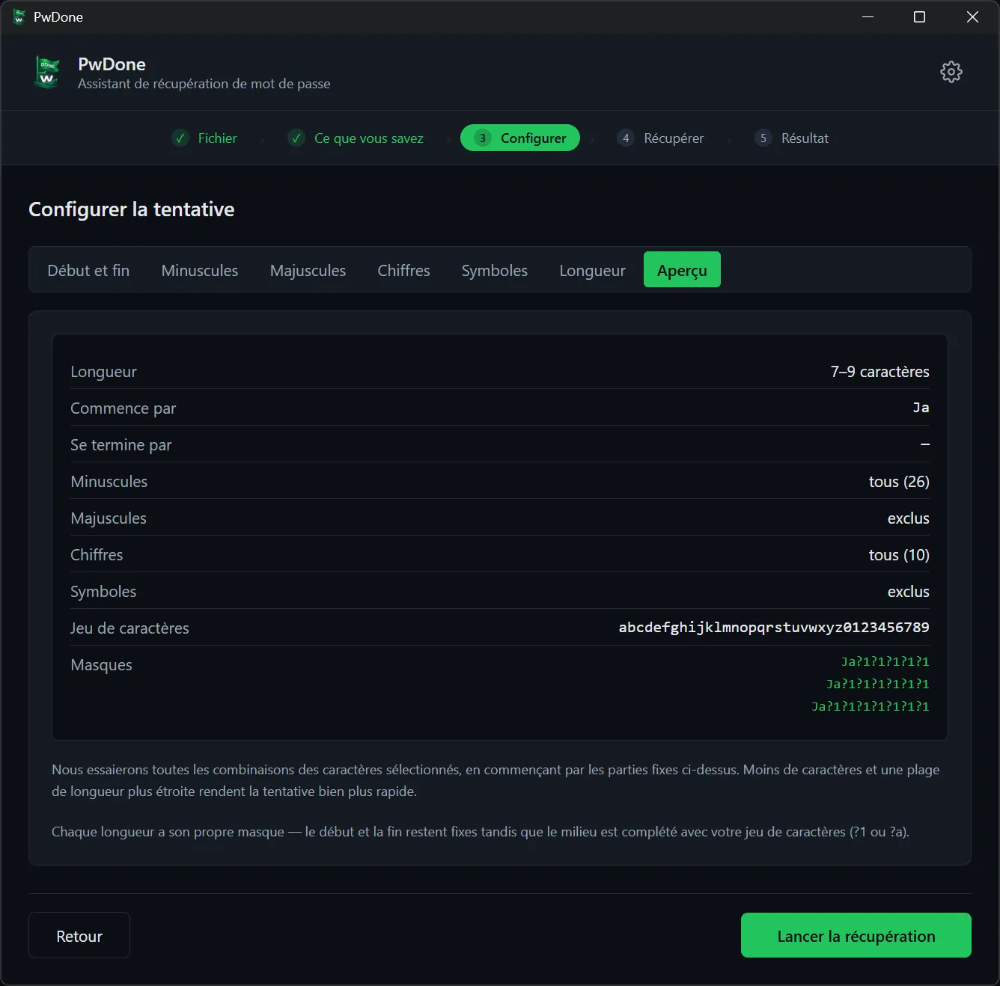
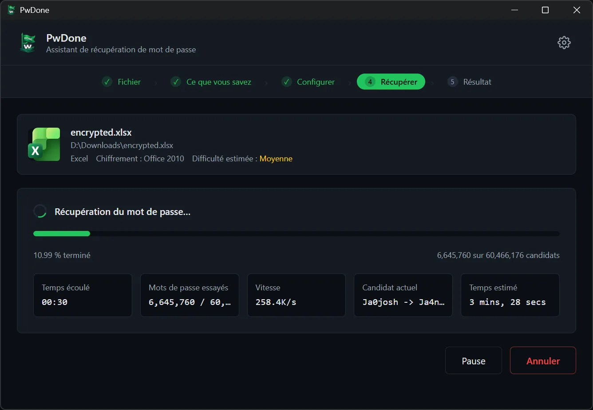
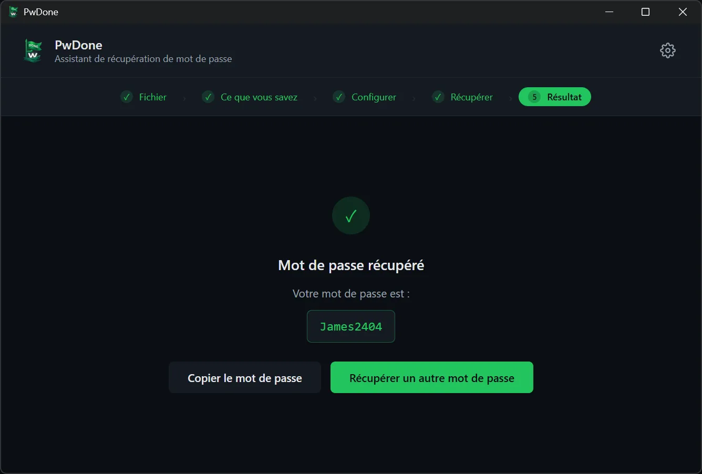

# PwDone

**Récupération locale de mots de passe pour vos propres fichiers chiffrés.**

[English](README.md) · [简体中文](README.zh.md) · [繁體中文](README.zh-Hant.md) · [日本語](README.ja.md) · [한국어](README.ko.md) · [Deutsch](README.de.md) · [Español](README.es.md) · **Français** · [Italiano](README.it.md) · [Nederlands](README.nl.md) · [Polski](README.pl.md) · [Português](README.pt.md)

PwDone vous aide à retrouver l'accès à vos propres fichiers ZIP, RAR, 7z, PDF,
Word, Excel et PowerPoint protégés par mot de passe. Tout s'exécute sur votre
appareil : les fichiers, les hachages et les mots de passe récupérés ne quittent
jamais votre ordinateur.

[Télécharger](https://pwdone.com/download) · [Documentation](https://pwdone.com/docs) · [Tarifs](https://pwdone.com/pricing) · [Comparatif](https://pwdone.com/alternatives) · [Kit presse](https://pwdone.com/press)

## Déroulement

**1. Fichier** — Sélectionnez un fichier chiffré ; PwDone détecte le format et extrait le hachage localement.

**2. Ce que vous savez** — Indiquez ce dont vous vous souvenez : une partie, un mot de passe courant ou rien.

**3. Configurer** — Réglez la longueur, les caractères ou les parties dont vous vous souvenez.

**4. Récupérer** — Suivez la progression, la vitesse et le candidat actuel ; mettez en pause à tout moment.

**5. Résultat** — Copiez le mot de passe récupéré ou essayez une autre méthode.

## Fonctionnalités

- Récupère les mots de passe de vos propres fichiers ZIP, RAR, 7z, PDF, Word, Excel et PowerPoint.
- Détecte le format et extrait le hachage localement.
- Intègre Hashcat (GPU) et John the Ripper (CPU), sans ligne de commande.
- Tout est local ; les fichiers, hachages et mots de passe ne sont jamais envoyés.
- Conserve l'historique local pour que les nouvelles tentatives soient instantanées.

## Formats pris en charge

| Format | Extensions | Édition |
| --- | --- | --- |
| ZIP | `.zip` | Archives |
| RAR | `.rar` | Archives |
| 7z | `.7z` | Archives |
| PDF | `.pdf` | PDF |
| Word | `.doc`, `.docx` | Office |
| Excel | `.xls`, `.xlsx` | Office |
| PowerPoint | `.ppt`, `.pptx` | Office |

## Confidentialité

- Traitement 100 % local.
- Aucun compte requis.
- Aucune télémétrie ni suivi d'utilisation dans l'application.
- L'historique de récupération reste local et peut être effacé à tout moment.

## Téléchargement

- **Windows** 10/11 (64 bits)
- **macOS** 14+ (Apple Silicon)

Installateurs et sommes SHA256 : <https://pwdone.com/download>

> Si Windows SmartScreen affiche un avertissement, consultez le guide de la page
> de téléchargement (« Informations complémentaires » → « Exécuter quand même »).

Détails complets dans le [README en anglais](README.md).
