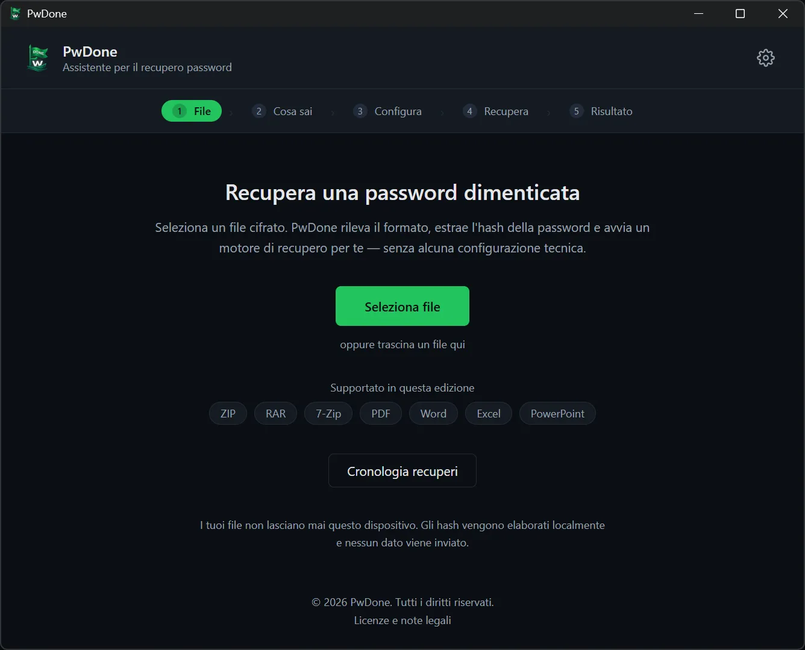
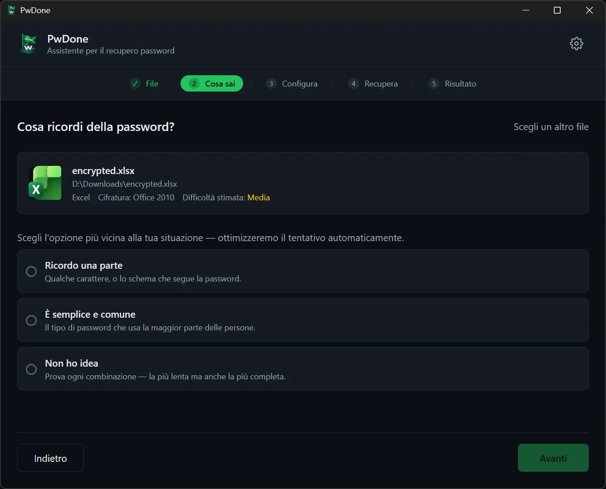
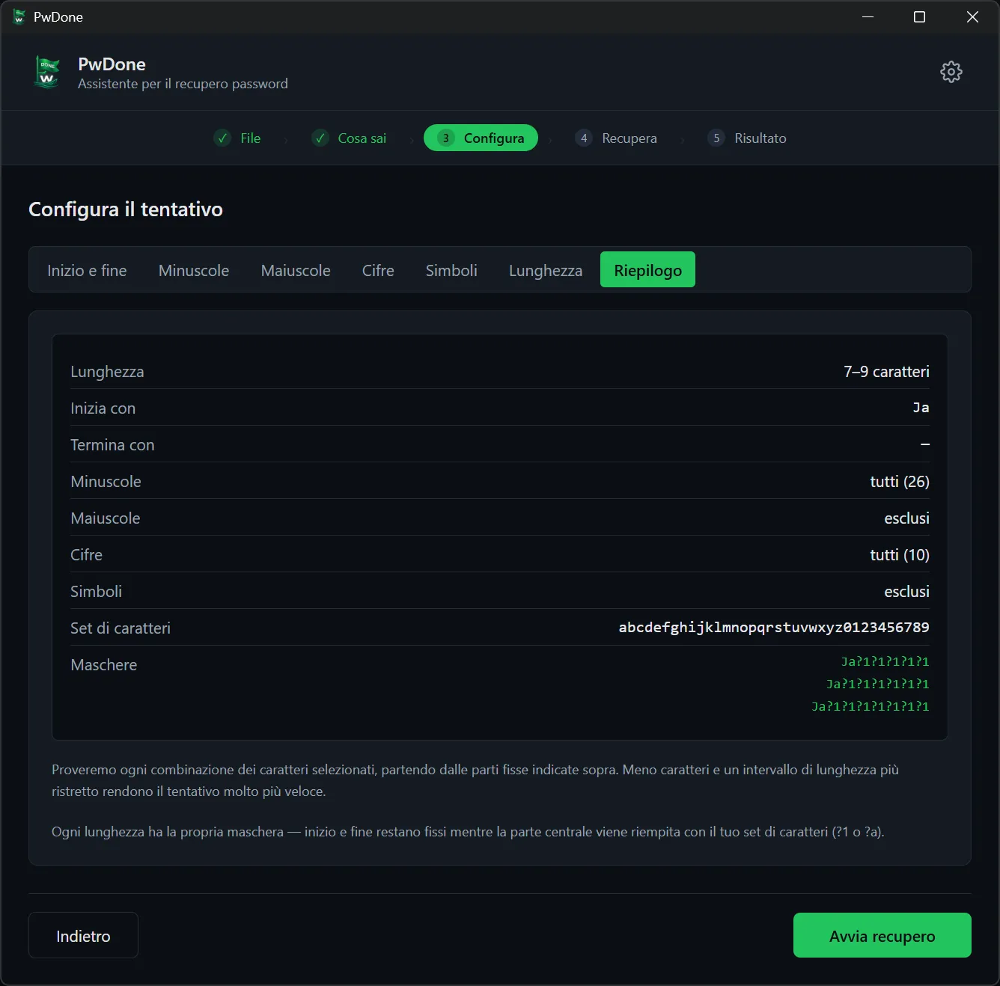
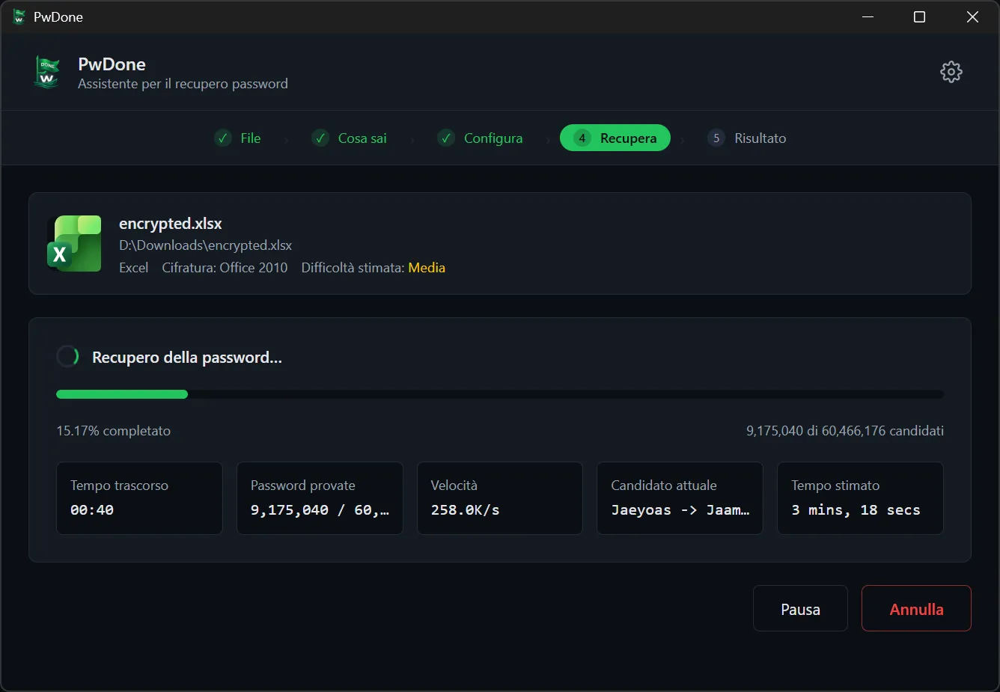
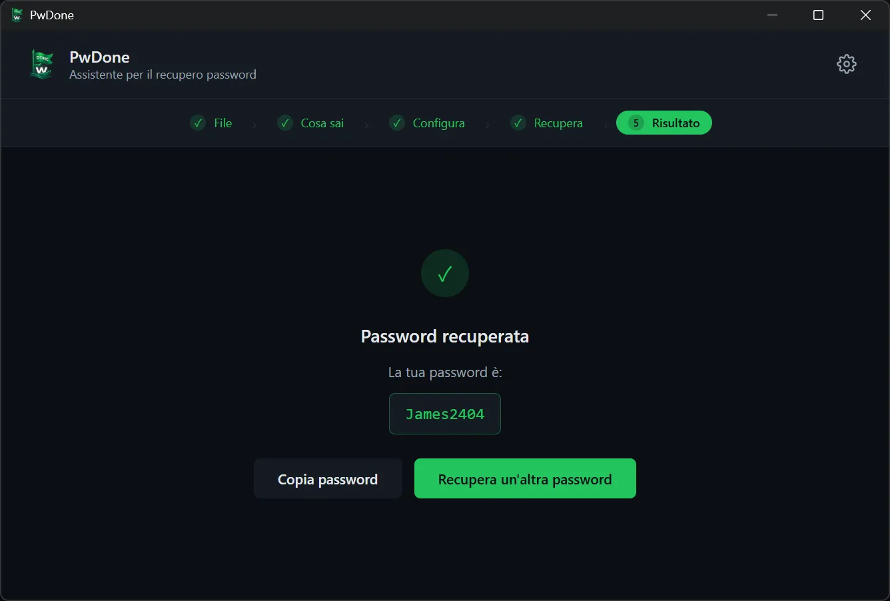

# PwDone

**Recupero locale delle password per i tuoi file cifrati.**

[English](README.md) · [简体中文](README.zh.md) · [繁體中文](README.zh-Hant.md) · [日本語](README.ja.md) · [한국어](README.ko.md) · [Deutsch](README.de.md) · [Español](README.es.md) · [Français](README.fr.md) · **Italiano** · [Nederlands](README.nl.md) · [Polski](README.pl.md) · [Português](README.pt.md)

PwDone ti aiuta a riottenere l'accesso ai tuoi file ZIP, RAR, 7z, PDF, Word, Excel
e PowerPoint protetti da password. Tutto viene eseguito sul tuo dispositivo: file,
hash e password recuperate non lasciano mai il tuo computer.

[Scarica](https://pwdone.com/download) · [Documentazione](https://pwdone.com/docs) · [Prezzi](https://pwdone.com/pricing) · [Confronto](https://pwdone.com/alternatives) · [Press kit](https://pwdone.com/press)

## Flusso di lavoro

**1. File** — Seleziona un file cifrato; PwDone rileva il formato ed estrae l'hash localmente.

**2. Cosa sai** — Indica cosa ricordi della password: una parte, una password comune o nulla.

**3. Configura** — Imposta la lunghezza, i caratteri o le parti che ricordi.

**4. Recupera** — Segui avanzamento, velocità e candidato corrente; metti in pausa quando vuoi.

**5. Risultato** — Copia la password recuperata o prova un altro metodo.

## Funzionalità

- Recupera le password dei tuoi file ZIP, RAR, 7z, PDF, Word, Excel e PowerPoint.
- Rileva il formato ed estrae l'hash localmente.
- Include Hashcat (GPU) e John the Ripper (CPU), senza riga di comando.
- Tutto in locale; file, hash e password non vengono mai caricati.
- Mantiene la cronologia locale per rendere istantanei i nuovi tentativi.

## Formati supportati

| Formato | Estensioni | Edizione |
| --- | --- | --- |
| ZIP | `.zip` | Archives |
| RAR | `.rar` | Archives |
| 7z | `.7z` | Archives |
| PDF | `.pdf` | PDF |
| Word | `.doc`, `.docx` | Office |
| Excel | `.xls`, `.xlsx` | Office |
| PowerPoint | `.ppt`, `.pptx` | Office |

## Privacy

- Elaborazione 100% locale.
- Nessun account richiesto.
- Nessuna telemetria né tracciamento dell'utilizzo nell'app.
- La cronologia di recupero resta locale e può essere cancellata in qualsiasi momento.

## Download

- **Windows** 10/11 (64 bit)
- **macOS** 14+ (Apple Silicon)

Programmi di installazione e checksum SHA256: <https://pwdone.com/download>

> Se Windows SmartScreen mostra un avviso, consulta la guida nella pagina di
> download («Ulteriori informazioni» → «Esegui comunque»).

Dettagli completi nel [README in inglese](README.md).
