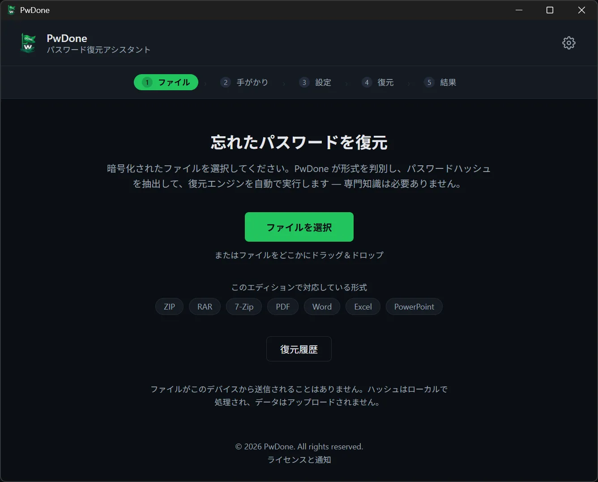
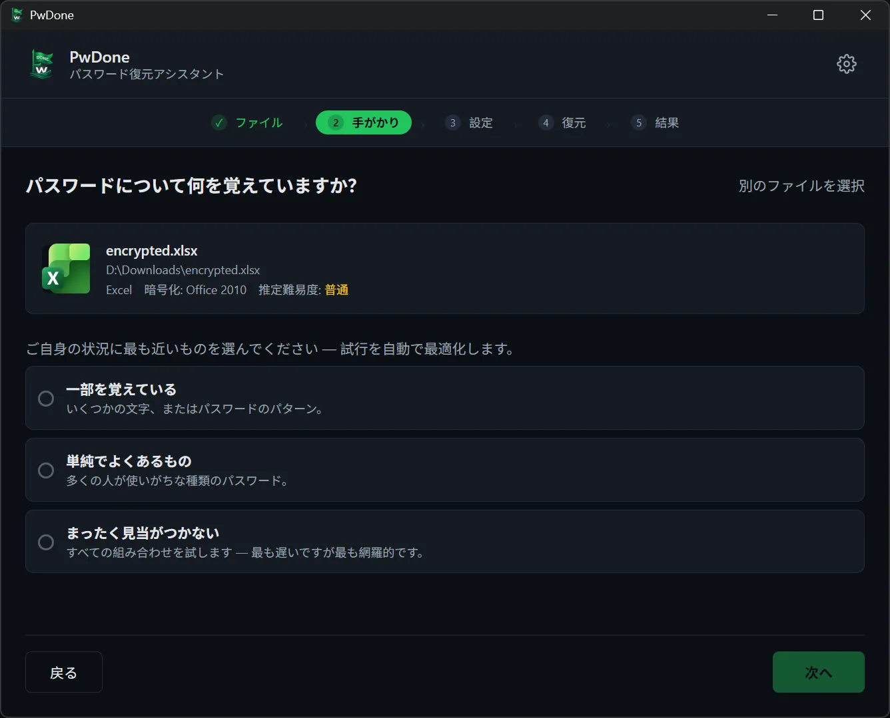
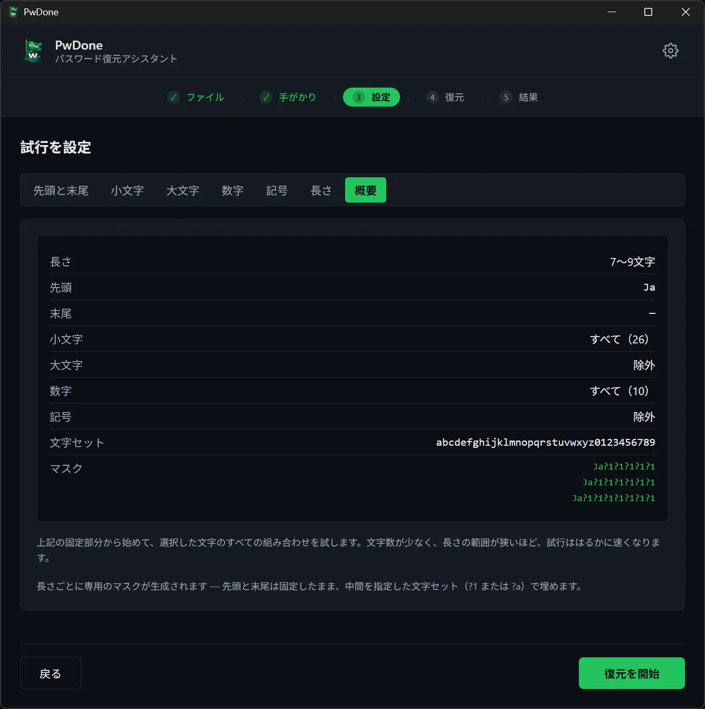
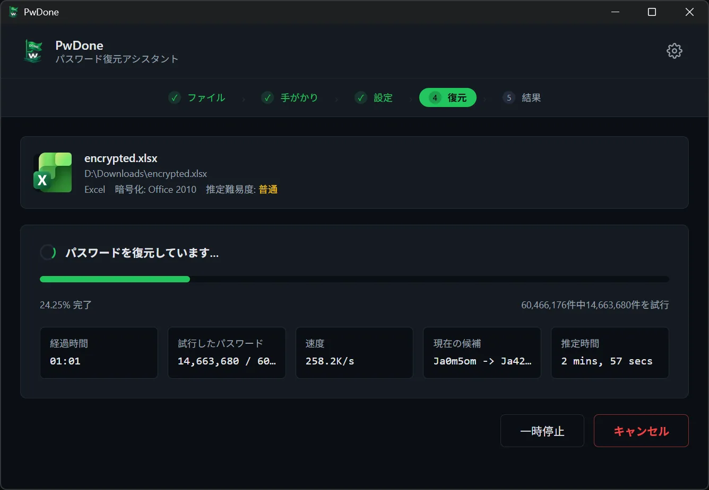
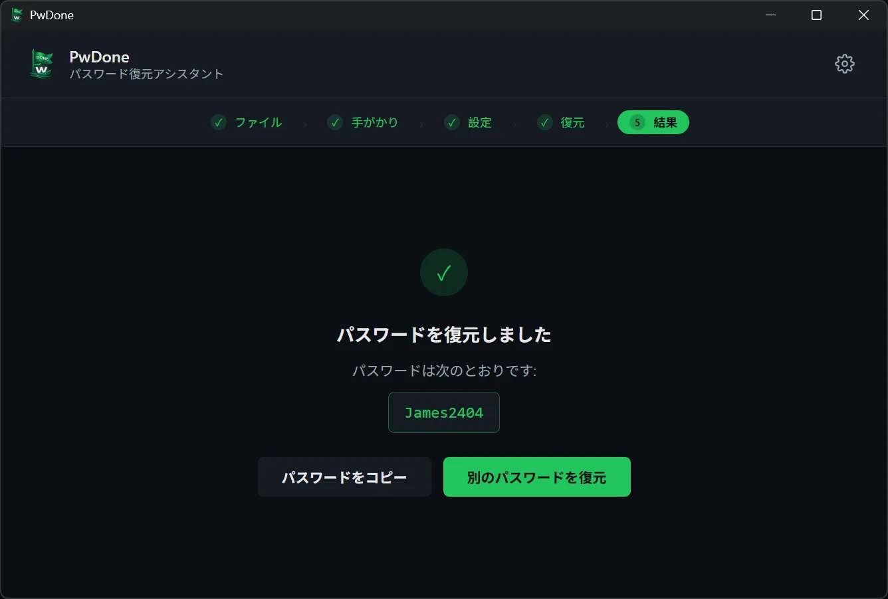

# PwDone

**ローカル優先の、自分が所有する暗号化ファイルのパスワード復元ツール。**

[English](README.md) · [简体中文](README.zh.md) · [繁體中文](README.zh-Hant.md) · **日本語** · [한국어](README.ko.md) · [Deutsch](README.de.md) · [Español](README.es.md) · [Français](README.fr.md) · [Italiano](README.it.md) · [Nederlands](README.nl.md) · [Polski](README.pl.md) · [Português](README.pt.md)

PwDone は、自分が所有するパスワード保護付きの ZIP、RAR、7z、PDF、Word、Excel、
PowerPoint ファイルへのアクセスを取り戻すためのアプリです。処理はすべて端末上で
行われ、ファイル・ハッシュ・復元したパスワードが外部に送信されることはありません。

[ダウンロード](https://pwdone.com/download) · [ドキュメント](https://pwdone.com/docs) · [価格](https://pwdone.com/pricing) · [比較](https://pwdone.com/alternatives) · [プレスキット](https://pwdone.com/press)

## 使い方

**1. ファイル** — 暗号化ファイルを選択。形式を自動判別し、端末上でハッシュを抽出します。

**2. 手がかり** — パスワードについて覚えていることを選択します（一部、よくあるパスワード、まったく不明）。

**3. 設定** — 長さ、使用する文字、覚えている先頭・末尾や断片を設定します。

**4. 復元** — 進捗、速度、現在の候補を確認。いつでも一時停止・再開できます。

**5. 結果** — 復元したパスワードをコピー、または別の方法で再試行します。

## できること

- 自分が所有する ZIP、RAR、7z、PDF、Word、Excel、PowerPoint のパスワードを復元。
- ファイル形式を自動判別し、端末上で復元用ハッシュを抽出。
- Hashcat（GPU）と John the Ripper（CPU）を内蔵。コマンドライン不要。
- すべてローカル処理。ファイル・ハッシュ・パスワードを送信しません。
- 復元履歴を端末内に保存し、同じファイルの再試行をすぐに完了。

## 対応形式

| 形式 | 拡張子 | エディション |
| --- | --- | --- |
| ZIP | `.zip` | Archives |
| RAR | `.rar` | Archives |
| 7z | `.7z` | Archives |
| PDF | `.pdf` | PDF |
| Word | `.doc`, `.docx` | Office |
| Excel | `.xls`, `.xlsx` | Office |
| PowerPoint | `.ppt`, `.pptx` | Office |

## プライバシー

- 100% ローカル処理。
- アカウント不要。
- アプリ内にテレメトリや利用状況の追跡はありません。
- 復元履歴は端末内のみに保存され、いつでも削除できます。

## ダウンロード

- **Windows** 10/11（64 ビット）
- **macOS** 14+（Apple Silicon）

インストーラーと SHA256 チェックサム：<https://pwdone.com/download>

> Windows SmartScreen の警告が表示された場合は、ダウンロードページの
> 手順（「詳細情報」→「実行」）をご覧ください。

詳細は [英語 README](README.md) を参照してください。
