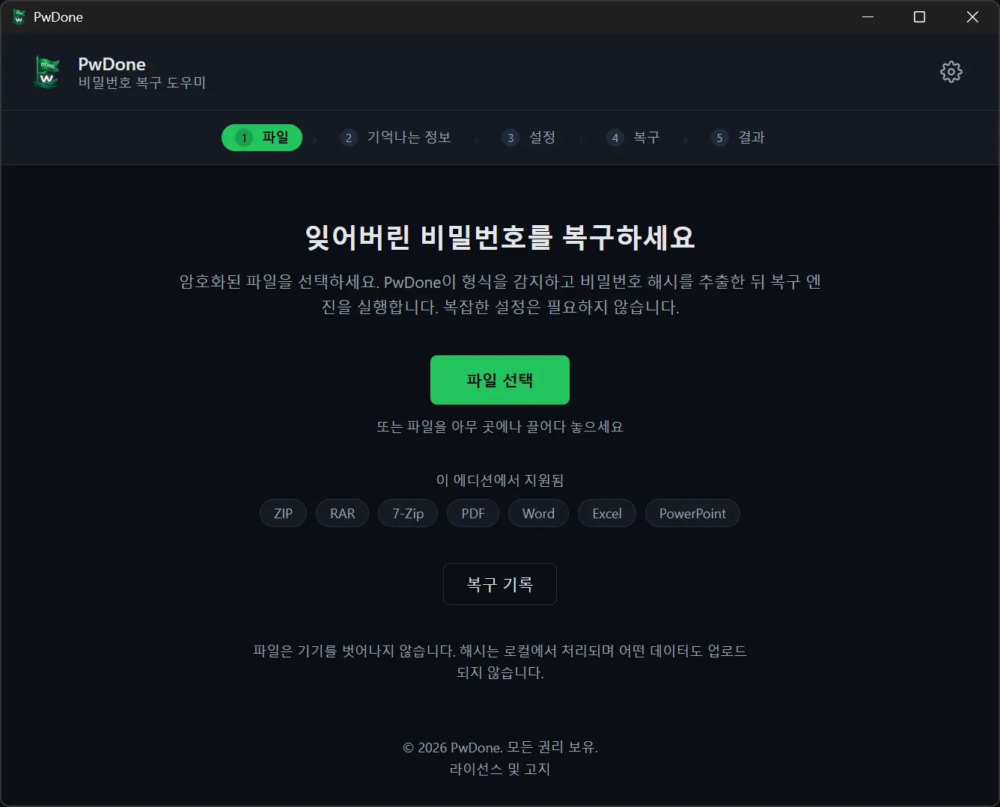
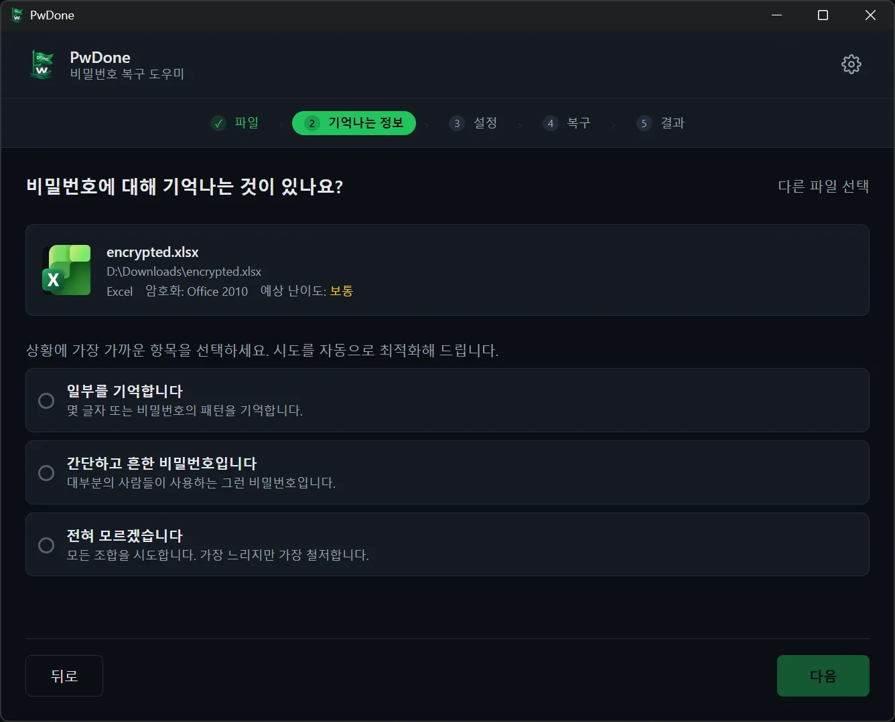
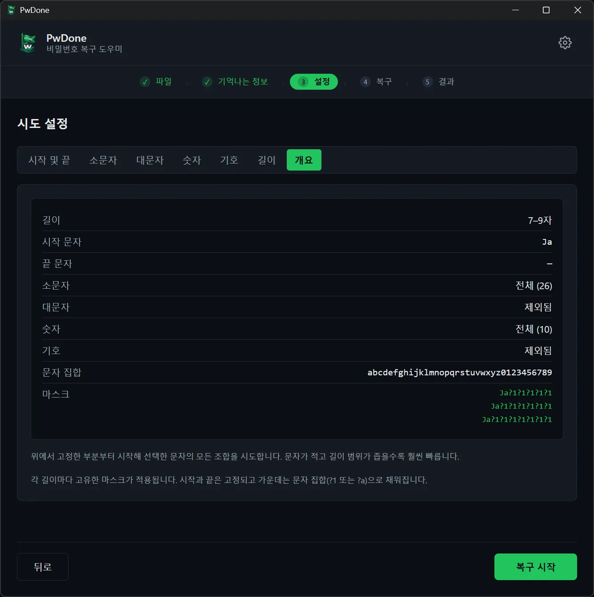
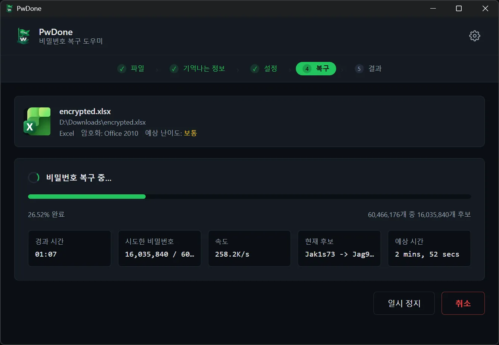
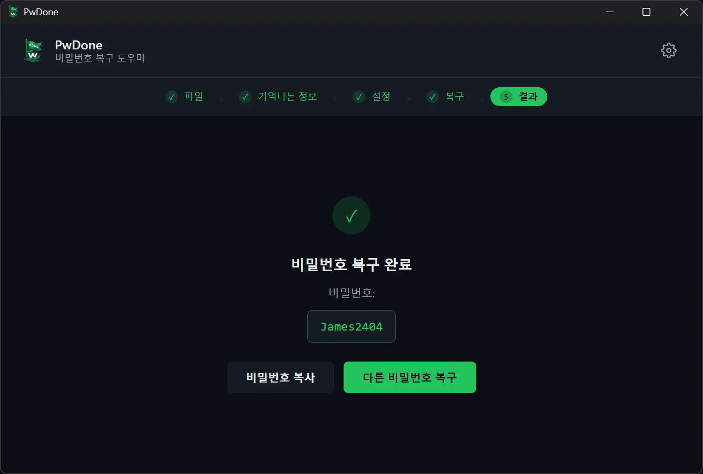

# PwDone

**본인 소유 암호화 파일을 위한 로컬 우선 비밀번호 복구 도구.**

[English](README.md) · [简体中文](README.zh.md) · [繁體中文](README.zh-Hant.md) · [日本語](README.ja.md) · **한국어** · [Deutsch](README.de.md) · [Español](README.es.md) · [Français](README.fr.md) · [Italiano](README.it.md) · [Nederlands](README.nl.md) · [Polski](README.pl.md) · [Português](README.pt.md)

PwDone은 본인이 소유한 암호로 보호된 ZIP, RAR, 7z, PDF, Word, Excel, PowerPoint
파일의 접근 권한을 되찾도록 도와줍니다. 모든 처리는 기기에서 이루어지며, 파일,
해시, 복구된 비밀번호는 외부로 전송되지 않습니다.

[다운로드](https://pwdone.com/download) · [문서](https://pwdone.com/docs) · [가격](https://pwdone.com/pricing) · [비교](https://pwdone.com/alternatives) · [프레스 키트](https://pwdone.com/press)

## 사용 흐름

**1. 파일** — 암호화 파일을 선택합니다. 형식을 자동 감지하고 기기에서 해시를 추출합니다.

**2. 기억나는 정보** — 비밀번호에 대해 기억나는 내용을 선택합니다(일부, 흔한 비밀번호, 전혀 모름).

**3. 설정** — 길이, 사용할 문자, 기억나는 시작/끝 부분이나 조각을 설정합니다.

**4. 복구** — 진행률, 속도, 현재 후보를 확인합니다. 언제든지 일시정지/재개할 수 있습니다.

**5. 결과** — 복구된 비밀번호를 복사하거나 다른 방법으로 다시 시도합니다.

## 기능

- 본인 소유 ZIP, RAR, 7z, PDF, Word, Excel, PowerPoint 파일의 비밀번호를 복구합니다.
- 파일 형식을 자동으로 감지하고 기기에서 복구 해시를 추출합니다.
- Hashcat(GPU)과 John the Ripper(CPU)를 내장해 명령줄이 필요 없습니다.
- 모든 처리는 로컬에서 이루어지며 파일, 해시, 비밀번호를 업로드하지 않습니다.
- 복구 기록을 기기에 저장해 같은 파일의 재시도를 즉시 완료합니다.

## 지원 형식

| 형식 | 확장자 | 에디션 |
| --- | --- | --- |
| ZIP | `.zip` | Archives |
| RAR | `.rar` | Archives |
| 7z | `.7z` | Archives |
| PDF | `.pdf` | PDF |
| Word | `.doc`, `.docx` | Office |
| Excel | `.xls`, `.xlsx` | Office |
| PowerPoint | `.ppt`, `.pptx` | Office |

## 개인정보 보호

- 100% 로컬 처리.
- 계정이 필요 없습니다.
- 앱 내 텔레메트리나 사용 추적이 없습니다.
- 복구 기록은 기기에만 저장되며 언제든지 삭제할 수 있습니다.

## 다운로드

- **Windows** 10/11(64비트)
- **macOS** 14+(Apple Silicon)

설치 프로그램 및 SHA256 체크섬: <https://pwdone.com/download>

> Windows SmartScreen 경고가 표시되면 다운로드 페이지의 안내
> ("추가 정보" → "실행")를 참고하세요.

자세한 내용은 [영문 README](README.md)를 참고하세요.
