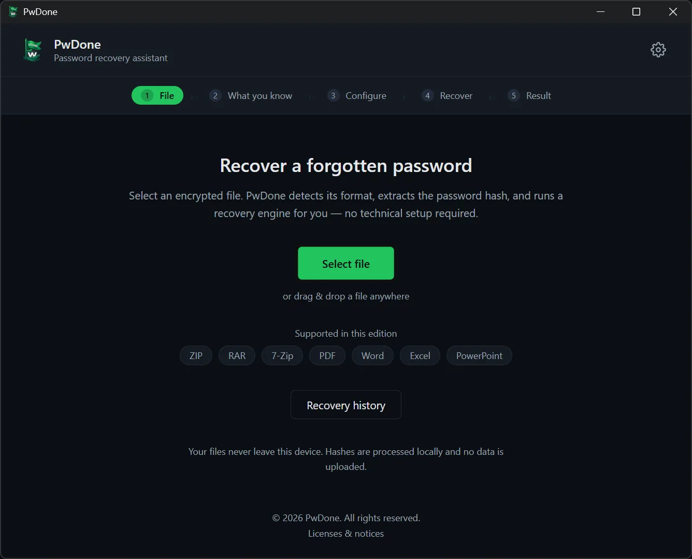
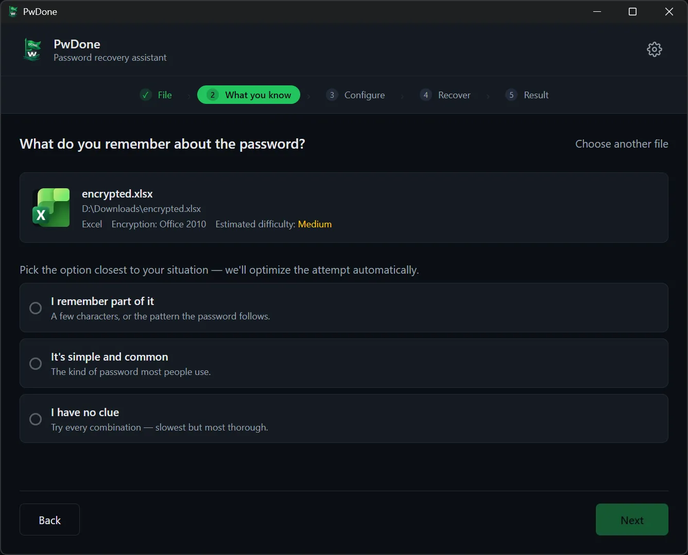
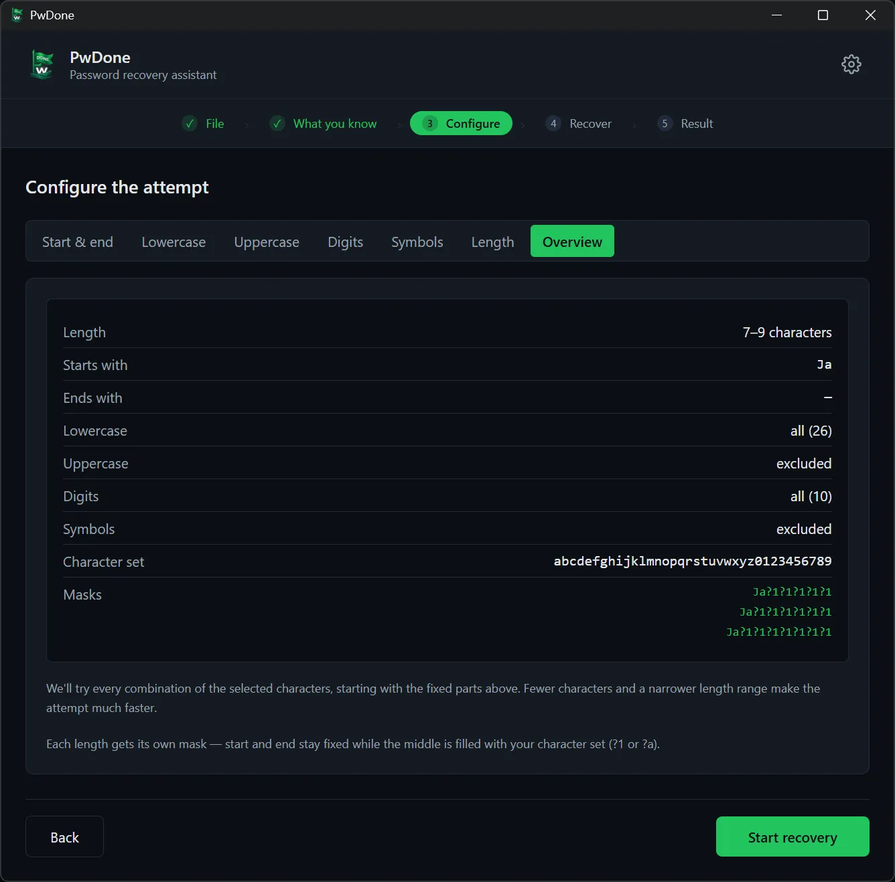
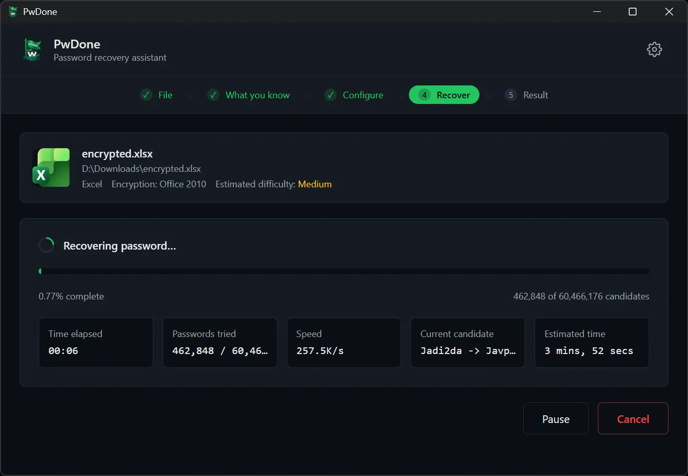
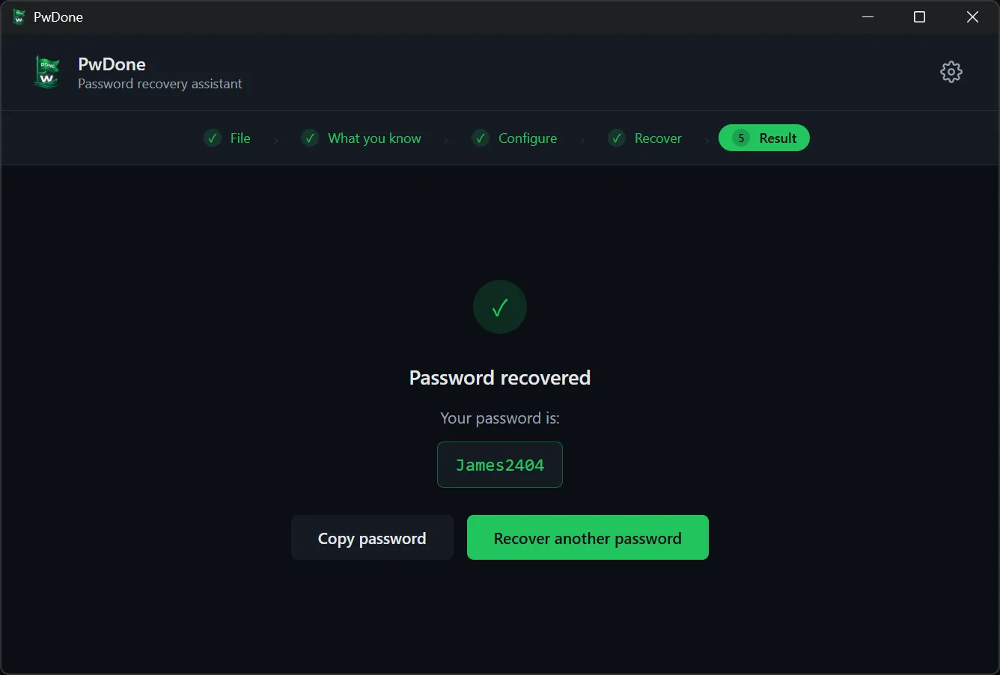

# PwDone

**Local-first password recovery for your own encrypted files.**

[English](README.md) · [简体中文](README.zh.md) · [繁體中文](README.zh-Hant.md) · [日本語](README.ja.md) · [한국어](README.ko.md) · [Deutsch](README.de.md) · [Español](README.es.md) · [Français](README.fr.md) · [Italiano](README.it.md) · [Nederlands](README.nl.md) · [Polski](README.pl.md) · [Português](README.pt.md)

PwDone helps you regain access to your own password-protected ZIP, RAR, 7z, PDF,
Word, Excel and PowerPoint files. Everything runs on your device: files, hashes
and recovered passwords never leave your computer.

[Download](https://pwdone.com/download) · [Documentation](https://pwdone.com/docs) · [Pricing](https://pwdone.com/pricing) · [Compare](https://pwdone.com/alternatives) · [Press kit](https://pwdone.com/press)

## Workflow

**1. File** — Select an encrypted file; PwDone detects the format and extracts the hash locally.

**2. What you know** — Tell PwDone what you remember about the password: part of it, a common password, or nothing at all.

**3. Configure** — Set the length, the characters to try, or the parts you remember.

**4. Recover** — Follow progress, speed and the current candidate; pause or resume at any time.

**5. Result** — Copy the recovered password, or try another method.

## What it does

- Recovers passwords for files you own: ZIP, RAR, 7z, PDF, Word, Excel and PowerPoint.
- Detects the format from the file contents and extracts the recovery hash locally.
- Validates and normalizes the hash before recovery.
- Runs Hashcat (GPU) and John the Ripper (CPU) behind a guided desktop workflow.
- Keeps a local recovery history so repeat attempts are instant.
- Never uploads files, hashes or recovered passwords.

## Supported formats

| Format | Extensions | Edition |
| --- | --- | --- |
| ZIP | `.zip` | Archives |
| RAR | `.rar` | Archives |
| 7z | `.7z` | Archives |
| PDF | `.pdf` | PDF |
| Word | `.doc`, `.docx` | Office |
| Excel | `.xls`, `.xlsx` | Office |
| PowerPoint | `.ppt`, `.pptx` | Office |

## How it works

1. **Detect** the format from the file contents.
2. **Extract** a recovery hash with a native extractor.
3. **Validate** and normalize the hash.
4. **Recover** with Hashcat or John the Ripper, with live progress.

## Privacy

- 100% local processing.
- No account required.
- No telemetry or usage tracking in the app.
- Recovered passwords are stored only in a local history you can clear.

Read the [privacy policy](https://pwdone.com/privacy).

## Download

- **Windows** 10/11 (64-bit)
- **macOS** 14+ (Apple Silicon)

Installers and SHA256 checksums: <https://pwdone.com/download>  
GitHub Releases mirror: [Releases](../../releases)

> If Windows SmartScreen shows a warning, see the download page for a short
> walkthrough ("More info" → "Run anyway").

## Languages

The app UI is available in English, 简体中文, 繁體中文, 日本語, 한국어, Deutsch,
Español, Français, Italiano, Nederlands, Polski and Português.

README translations are linked at the top. Localized screenshots live in
[`screenshots/`](screenshots/).

## FAQ

**Is my file uploaded?**  
No. Detection, extraction and recovery all run on your device.

**Can it recover any password?**  
No tool can guarantee that. Recovery depends on the password being inside the
search space you choose; strong passwords can take a very long time.

**Is this a cracking tool?**  
No. PwDone is for recovering access to files you own or are authorized to
access. Using it on someone else's files may be illegal.

**Does it work offline?**  
Yes. The app works without a network connection; a connection is only needed for
purchase and license activation.

## Links

- Website: <https://pwdone.com>
- Documentation: <https://pwdone.com/docs>
- Compare with other tools: <https://pwdone.com/alternatives>
- Press kit: <https://pwdone.com/press>
- Support: <support@pwdone.com>

## Repository

This repository is the **product hub** for PwDone: downloads, release notes,
documentation pointers and issue tracking. The application source code is
proprietary and not published here.

## License

PwDone is proprietary software. Binaries are governed by the
[EULA](https://pwdone.com/eula). "PwDone" and the PwDone logo are trademarks.
See [LICENSE](LICENSE).

## Security

Please report vulnerabilities privately. See [SECURITY.md](SECURITY.md).
