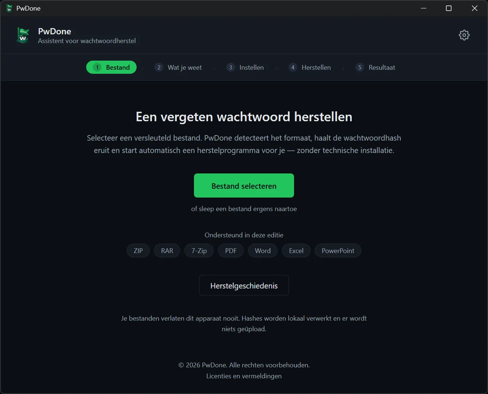
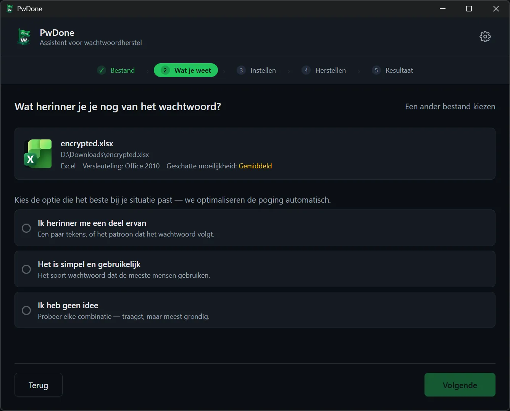
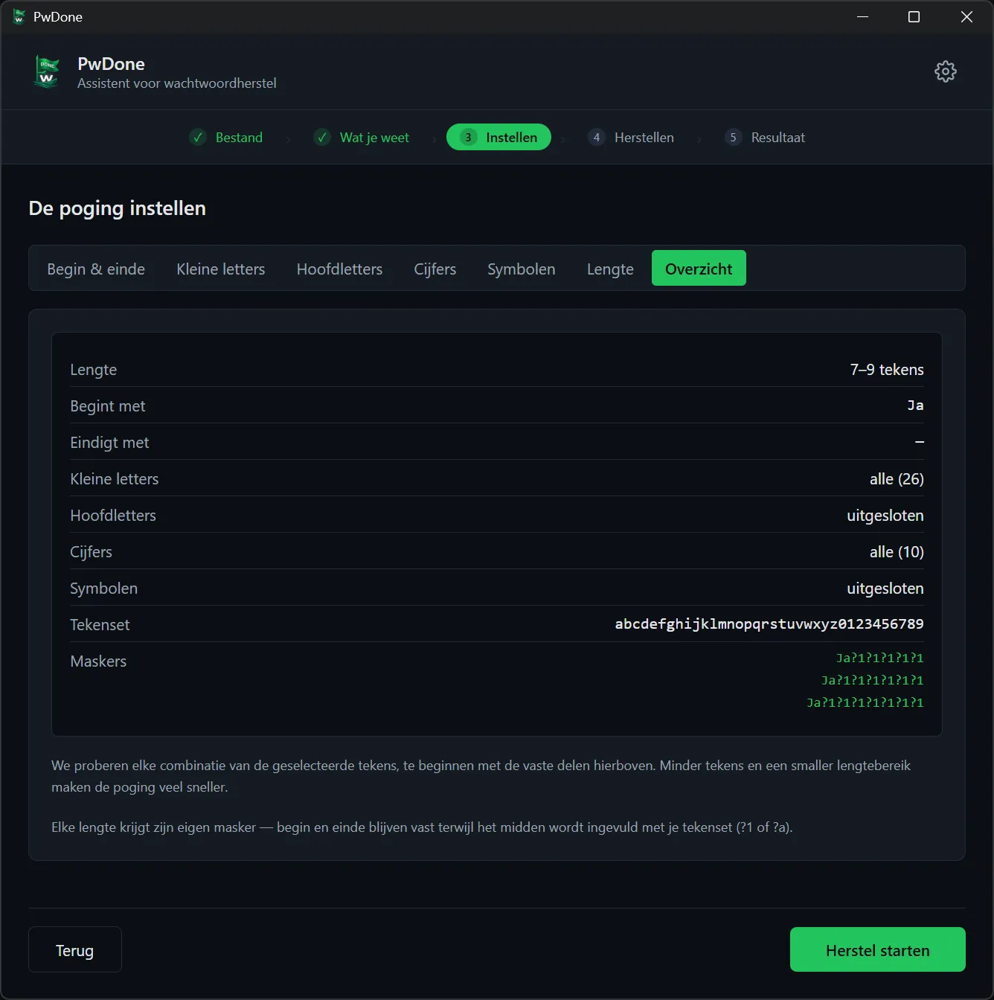
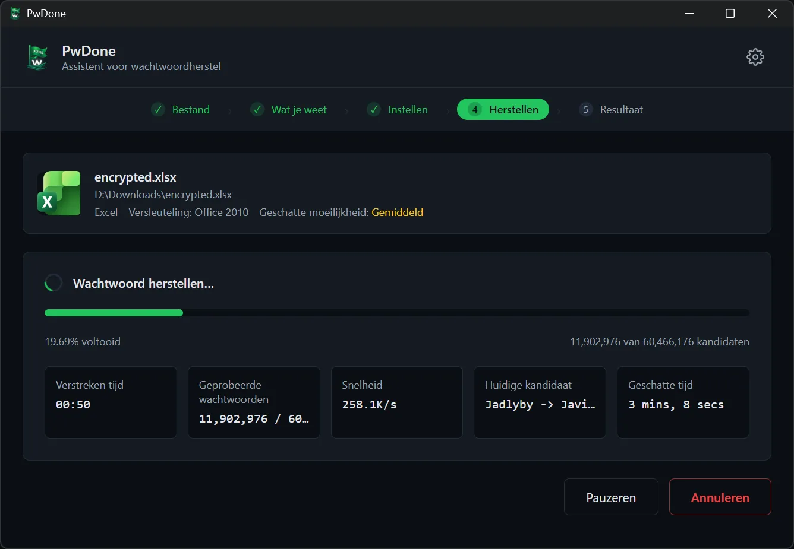
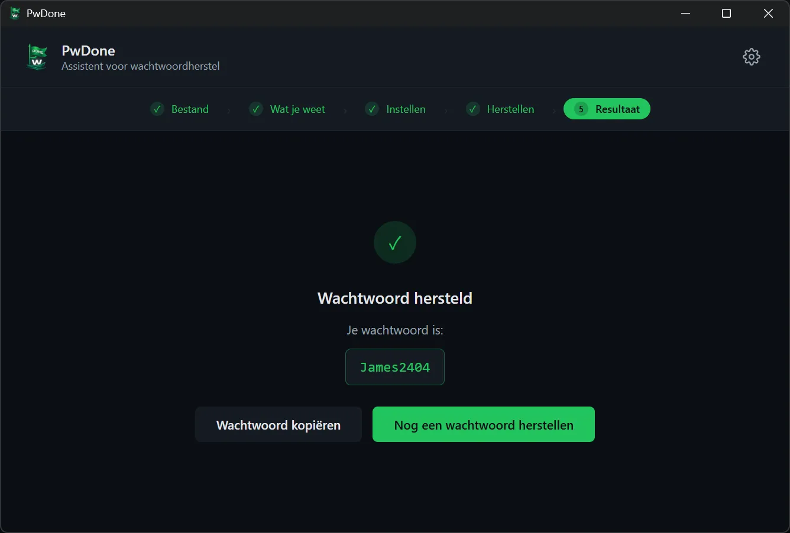

# PwDone

**Lokale wachtwoordherstel voor je eigen versleutelde bestanden.**

[English](README.md) · [简体中文](README.zh.md) · [繁體中文](README.zh-Hant.md) · [日本語](README.ja.md) · [한국어](README.ko.md) · [Deutsch](README.de.md) · [Español](README.es.md) · [Français](README.fr.md) · [Italiano](README.it.md) · **Nederlands** · [Polski](README.pl.md) · [Português](README.pt.md)

PwDone helpt je om weer toegang te krijgen tot je eigen met een wachtwoord
beveiligde ZIP-, RAR-, 7z-, PDF-, Word-, Excel- en PowerPoint-bestanden. Alles
draait op je apparaat: bestanden, hashes en herstelde wachtwoorden verlaten je
computer nooit.

[Download](https://pwdone.com/download) · [Documentatie](https://pwdone.com/docs) · [Prijzen](https://pwdone.com/pricing) · [Vergelijking](https://pwdone.com/alternatives) · [Perskit](https://pwdone.com/press)

## Werkwijze

**1. Bestand** — Kies een versleuteld bestand; PwDone detecteert het formaat en extraheert de hash lokaal.

**2. Wat je weet** — Geef aan wat je van het wachtwoord weet: een deel, een veelvoorkomend wachtwoord of niets.

**3. Instellen** — Stel de lengte, de tekens of de bekende delen in.

**4. Herstellen** — Volg voortgang, snelheid en de huidige kandidaat; pauzeer of hervat wanneer je wilt.

**5. Resultaat** — Kopieer het herstelde wachtwoord of probeer een andere methode.

## Functies

- Herstelt wachtwoorden voor je eigen ZIP-, RAR-, 7z-, PDF-, Word-, Excel- en PowerPoint-bestanden.
- Detecteert het formaat en extraheert de hash lokaal.
- Inclusief Hashcat (GPU) en John the Ripper (CPU), zonder opdrachtregel.
- Alles lokaal; bestanden, hashes en wachtwoorden worden nooit geüpload.
- Bewaart de geschiedenis lokaal, zodat nieuwe pogingen direct klaar zijn.

## Ondersteunde formaten

| Formaat | Extensies | Editie |
| --- | --- | --- |
| ZIP | `.zip` | Archives |
| RAR | `.rar` | Archives |
| 7z | `.7z` | Archives |
| PDF | `.pdf` | PDF |
| Word | `.doc`, `.docx` | Office |
| Excel | `.xls`, `.xlsx` | Office |
| PowerPoint | `.ppt`, `.pptx` | Office |

## Privacy

- 100% lokale verwerking.
- Geen account nodig.
- Geen telemetrie of gebruiksregistratie in de app.
- De herstelgeschiedenis blijft lokaal en kan altijd worden gewist.

## Download

- **Windows** 10/11 (64-bits)
- **macOS** 14+ (Apple Silicon)

Installatieprogramma's en SHA256-checksums: <https://pwdone.com/download>

> Als Windows SmartScreen een waarschuwing toont, bekijk dan de uitleg op de
> downloadpagina ("Meer informatie" → "Toch uitvoeren").

Volledige details in de [Engelse README](README.md).
