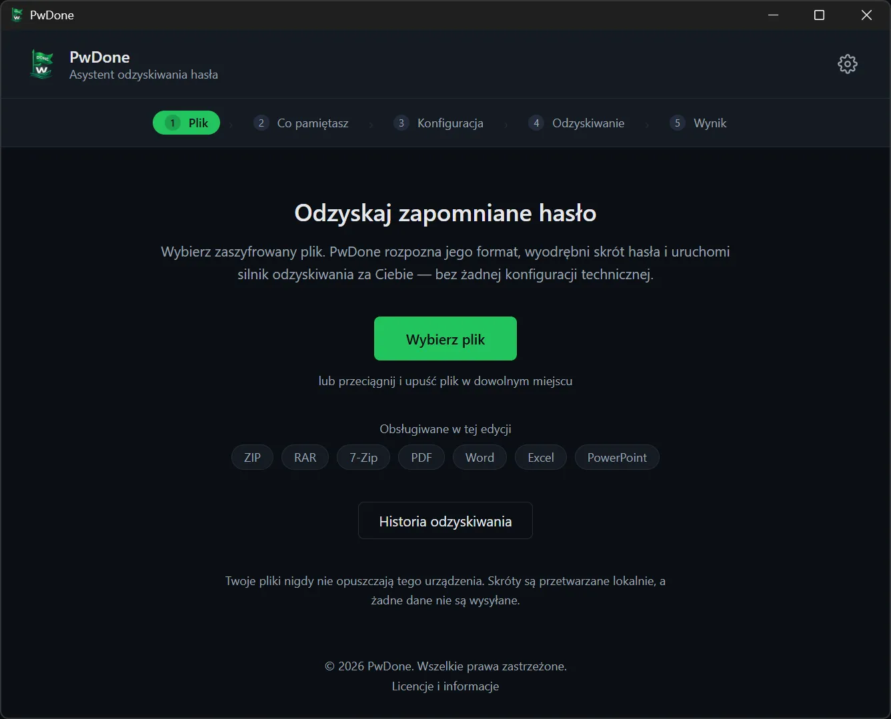
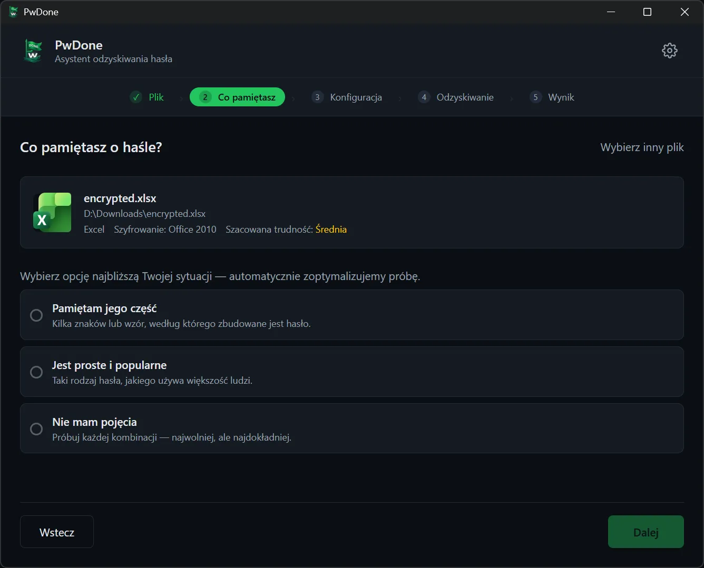
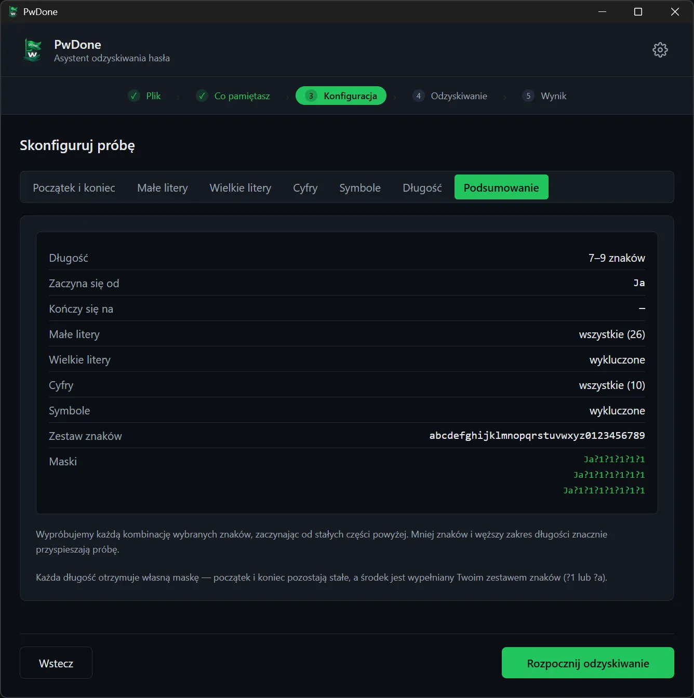
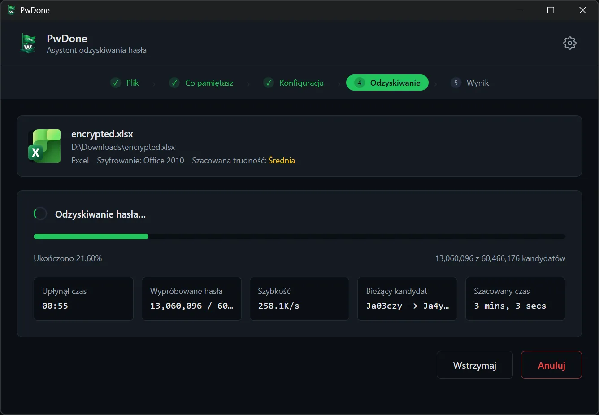
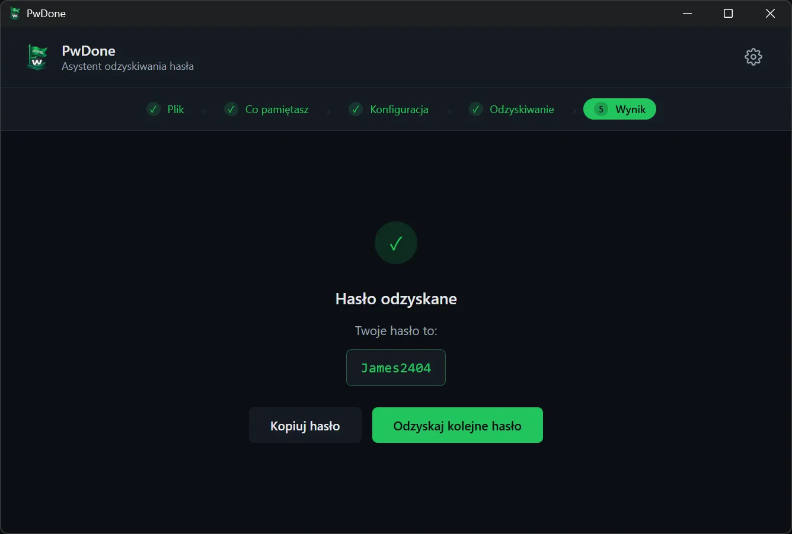

# PwDone

**Lokalne odzyskiwanie haseł do własnych zaszyfrowanych plików.**

[English](README.md) · [简体中文](README.zh.md) · [繁體中文](README.zh-Hant.md) · [日本語](README.ja.md) · [한국어](README.ko.md) · [Deutsch](README.de.md) · [Español](README.es.md) · [Français](README.fr.md) · [Italiano](README.it.md) · [Nederlands](README.nl.md) · **Polski** · [Português](README.pt.md)

PwDone pomaga odzyskać dostęp do własnych plików ZIP, RAR, 7z, PDF, Word, Excel
i PowerPoint chronionych hasłem. Wszystko działa na Twoim urządzeniu: pliki, hashe
i odzyskane hasła nigdy nie opuszczają Twojego komputera.

[Pobierz](https://pwdone.com/download) · [Dokumentacja](https://pwdone.com/docs) · [Cennik](https://pwdone.com/pricing) · [Porównanie](https://pwdone.com/alternatives) · [Press kit](https://pwdone.com/press)

## Przebieg

**1. Plik** — Wybierz zaszyfrowany plik; PwDone wykrywa format i lokalnie wyodrębnia hash.

**2. Co pamiętasz** — Wskaż, co pamiętasz o haśle: fragment, popularne hasło lub nic.

**3. Konfiguracja** — Ustaw długość, znaki lub znane fragmenty.

**4. Odzyskiwanie** — Śledź postęp, prędkość i bieżącego kandydata; wstrzymaj lub wznów w dowolnym momencie.

**5. Wynik** — Skopiuj odzyskane hasło lub spróbuj innej metody.

## Funkcje

- Odzyskuje hasła do własnych plików ZIP, RAR, 7z, PDF, Word, Excel i PowerPoint.
- Wykrywa format i lokalnie wyodrębnia hash.
- Zawiera Hashcat (GPU) i John the Ripper (CPU), bez wiersza poleceń.
- Wszystko lokalnie; pliki, hashe i hasła nie są nigdy wysyłane.
- Zapisuje historię lokalnie, więc ponowne próby są natychmiastowe.

## Obsługiwane formaty

| Format | Rozszerzenia | Edycja |
| --- | --- | --- |
| ZIP | `.zip` | Archives |
| RAR | `.rar` | Archives |
| 7z | `.7z` | Archives |
| PDF | `.pdf` | PDF |
| Word | `.doc`, `.docx` | Office |
| Excel | `.xls`, `.xlsx` | Office |
| PowerPoint | `.ppt`, `.pptx` | Office |

## Prywatność

- 100% lokalne przetwarzanie.
- Konto nie jest wymagane.
- Brak telemetrii i śledzenia użycia w aplikacji.
- Historia odzyskiwania pozostaje lokalnie i można ją w każdej chwili wyczyścić.

## Pobieranie

- **Windows** 10/11 (64-bit)
- **macOS** 14+ (Apple Silicon)

Instalatory i sumy SHA256: <https://pwdone.com/download>

> Jeśli Windows SmartScreen wyświetli ostrzeżenie, zobacz instrukcję na stronie
> pobierania („Więcej informacji” → „Uruchom mimo to”).

Pełne szczegóły w [angielskim README](README.md).
