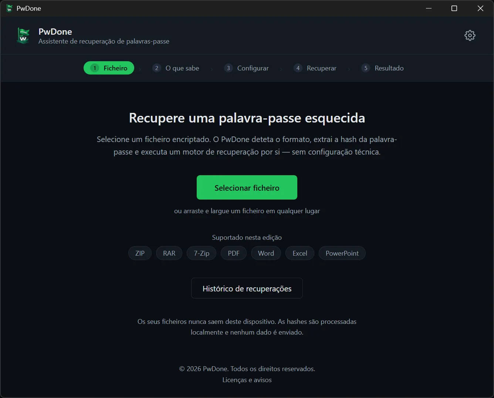
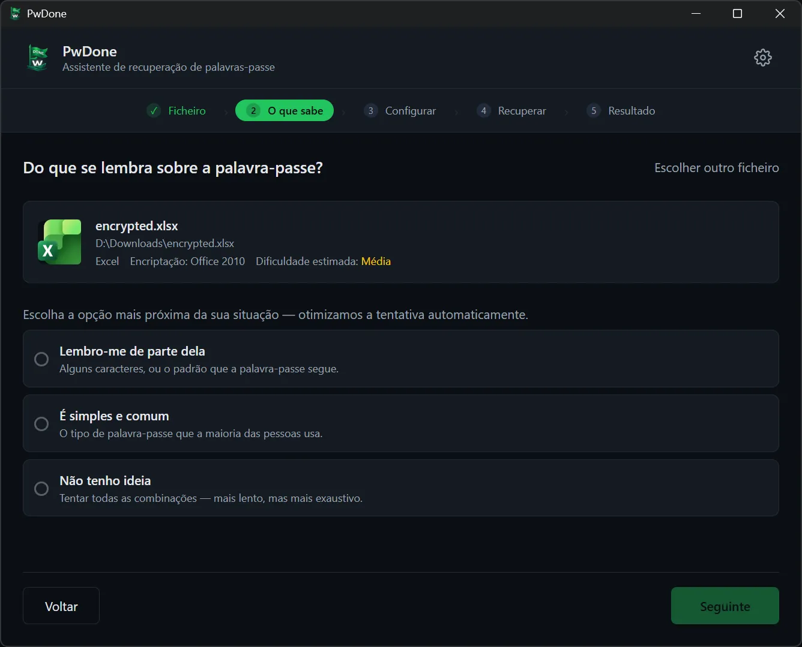
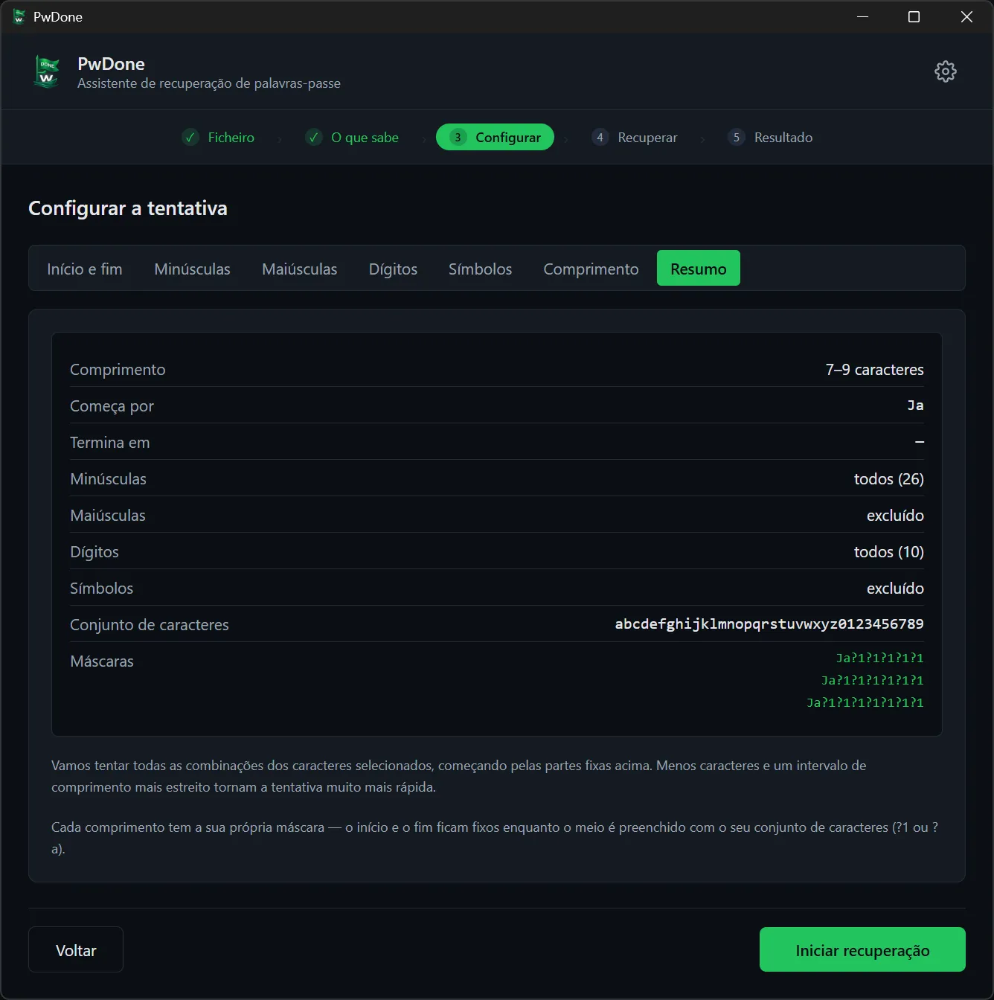
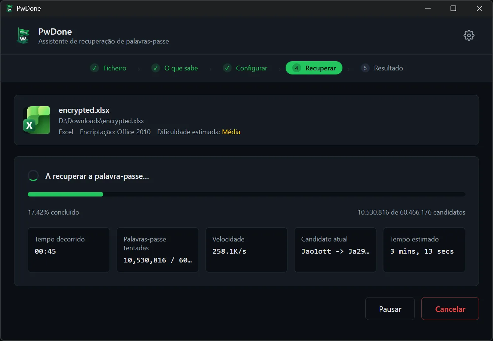
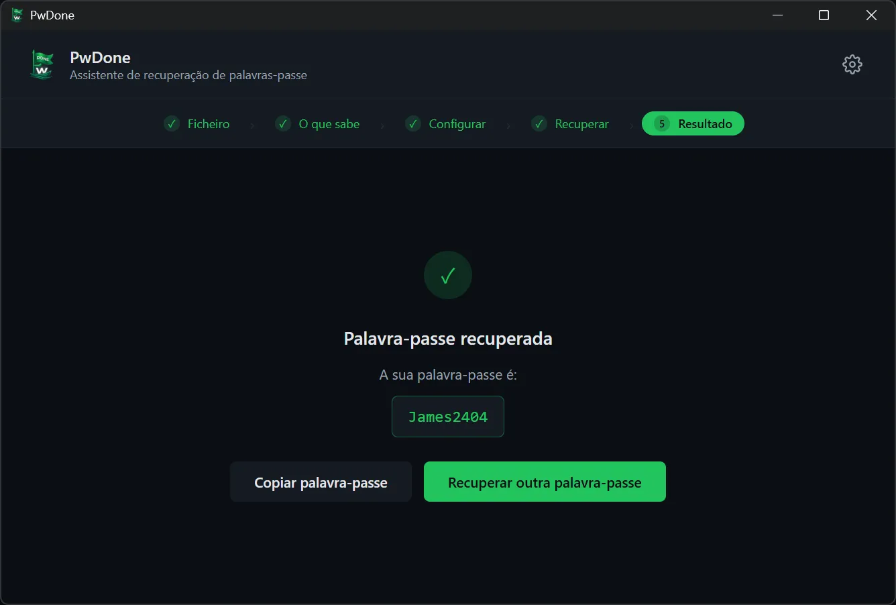

# PwDone

**Recuperação local de palavras-passe para os seus próprios ficheiros encriptados.**

[English](README.md) · [简体中文](README.zh.md) · [繁體中文](README.zh-Hant.md) · [日本語](README.ja.md) · [한국어](README.ko.md) · [Deutsch](README.de.md) · [Español](README.es.md) · [Français](README.fr.md) · [Italiano](README.it.md) · [Nederlands](README.nl.md) · [Polski](README.pl.md) · **Português**

O PwDone ajuda-o a recuperar o acesso aos seus próprios ficheiros ZIP, RAR, 7z,
PDF, Word, Excel e PowerPoint protegidos por palavra-passe. Tudo é executado no
seu dispositivo: ficheiros, hashes e palavras-passe recuperadas nunca saem do seu
computador.

[Transferir](https://pwdone.com/download) · [Documentação](https://pwdone.com/docs) · [Preços](https://pwdone.com/pricing) · [Comparação](https://pwdone.com/alternatives) · [Kit de imprensa](https://pwdone.com/press)

## Fluxo de trabalho

**1. Ficheiro** — Selecione um ficheiro encriptado; o PwDone deteta o formato e extrai a hash localmente.

**2. O que sabe** — Indique o que se lembra da palavra-passe: uma parte, uma palavra-passe comum ou nada.

**3. Configurar** — Defina o comprimento, os caracteres ou as partes de que se lembra.

**4. Recuperar** — Acompanhe o progresso, a velocidade e o candidato atual; pause ou retome quando quiser.

**5. Resultado** — Copie a palavra-passe recuperada ou experimente outro método.

## Funcionalidades

- Recupera palavras-passe dos seus próprios ficheiros ZIP, RAR, 7z, PDF, Word, Excel e PowerPoint.
- Deteta o formato e extrai a hash localmente.
- Inclui Hashcat (GPU) e John the Ripper (CPU), sem linha de comandos.
- Tudo local; ficheiros, hashes e palavras-passe nunca são enviados.
- Mantém o histórico local para que novas tentativas sejam instantâneas.

## Formatos suportados

| Formato | Extensões | Edição |
| --- | --- | --- |
| ZIP | `.zip` | Archives |
| RAR | `.rar` | Archives |
| 7z | `.7z` | Archives |
| PDF | `.pdf` | PDF |
| Word | `.doc`, `.docx` | Office |
| Excel | `.xls`, `.xlsx` | Office |
| PowerPoint | `.ppt`, `.pptx` | Office |

## Privacidade

- Processamento 100% local.
- Não exige conta.
- Sem telemetria nem rastreio de utilização na aplicação.
- O histórico de recuperação fica local e pode ser apagado a qualquer momento.

## Transferência

- **Windows** 10/11 (64 bits)
- **macOS** 14+ (Apple Silicon)

Instaladores e checksums SHA256: <https://pwdone.com/download>

> Se o Windows SmartScreen mostrar um aviso, consulte o guia na página de
> transferência ("Mais informações" → "Executar mesmo assim").

Detalhes completos no [README em inglês](README.md).
