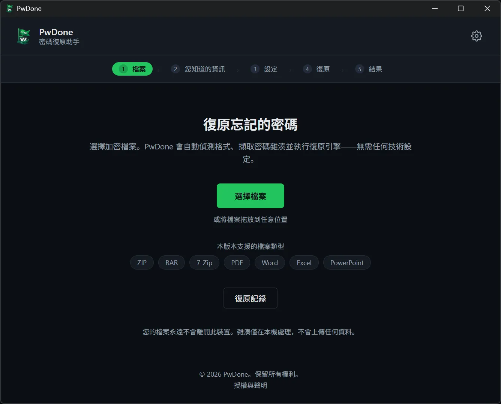
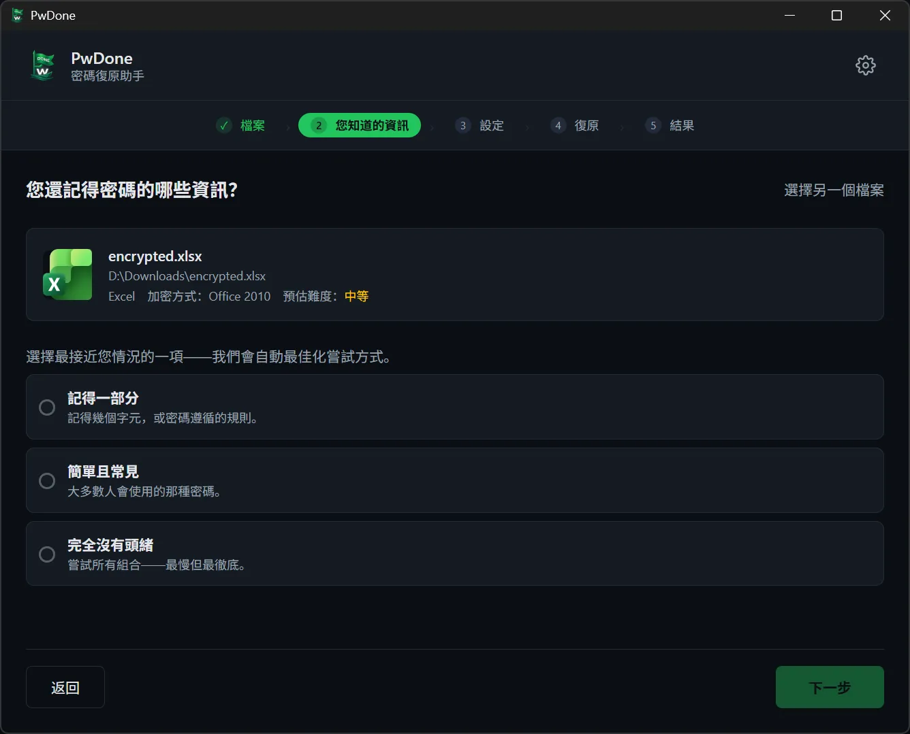
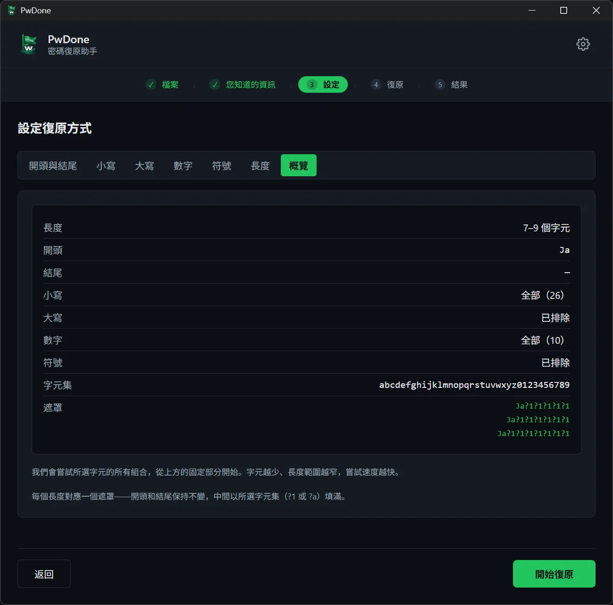
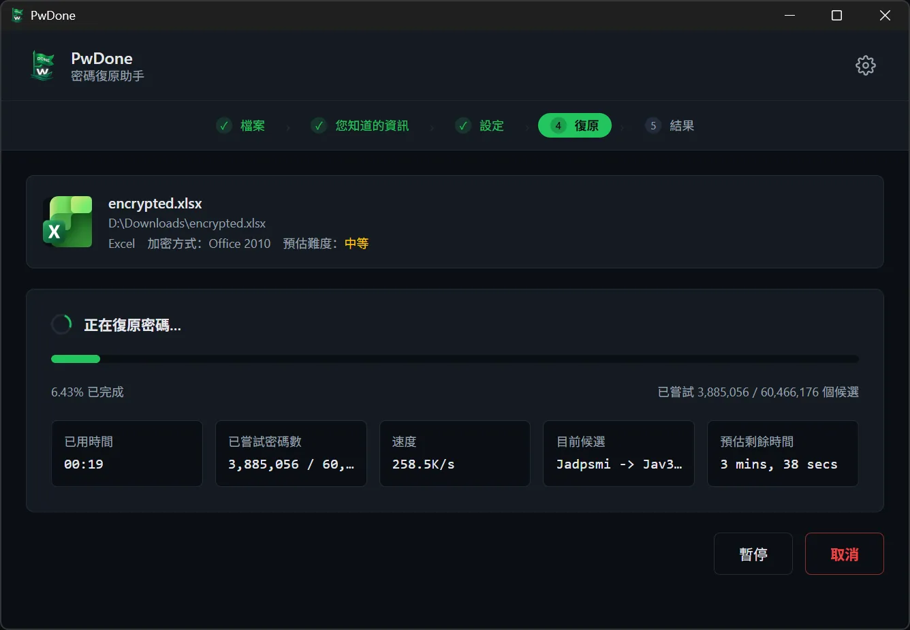
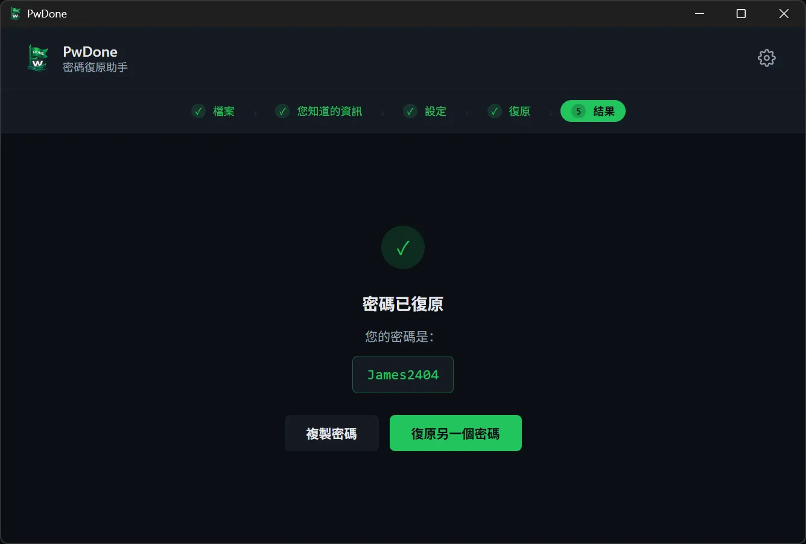

# PwDone

**本機優先的自有加密檔案密碼復原工具。**

[English](README.md) · [简体中文](README.zh.md) · **繁體中文** · [日本語](README.ja.md) · [한국어](README.ko.md) · [Deutsch](README.de.md) · [Español](README.es.md) · [Français](README.fr.md) · [Italiano](README.it.md) · [Nederlands](README.nl.md) · [Polski](README.pl.md) · [Português](README.pt.md)

PwDone 協助你復原自己擁有的、受密碼保護的 ZIP、RAR、7z、PDF、Word、Excel 與
PowerPoint 檔案存取權。所有處理都在你的裝置上完成：檔案、雜湊與復原出的密碼
都不會離開你的電腦。

[下載](https://pwdone.com/download) · [文件](https://pwdone.com/docs) · [價格](https://pwdone.com/pricing) · [比較](https://pwdone.com/alternatives) · [媒體資料](https://pwdone.com/press)

## 工作流程

**1. 檔案** — 選擇加密檔案；PwDone 自動偵測格式並在本機擷取雜湊。

**2. 您知道的資訊** — 告訴 PwDone 你對密碼的了解：記得一部分、常見密碼，或完全不知道。

**3. 設定** — 設定長度、要嘗試的字元，或你記得的片段。

**4. 復原** — 查看進度、速度和目前候選；可隨時暫停或繼續。

**5. 結果** — 複製復原出的密碼，或改用其他方法再試。

## 功能

- 復原你自己檔案的密碼：ZIP、RAR、7z、PDF、Word、Excel、PowerPoint。
- 自動偵測檔案格式，並在本機擷取復原雜湊。
- 內建 Hashcat（GPU）與 John the Ripper（CPU），無需命令列。
- 全程本機處理，不上傳檔案、雜湊或復原出的密碼。
- 本機保存復原紀錄，重複嘗試可立即取得結果。

## 支援格式

| 格式 | 副檔名 | 版本 |
| --- | --- | --- |
| ZIP | `.zip` | Archives |
| RAR | `.rar` | Archives |
| 7z | `.7z` | Archives |
| PDF | `.pdf` | PDF |
| Word | `.doc`, `.docx` | Office |
| Excel | `.xls`, `.xlsx` | Office |
| PowerPoint | `.ppt`, `.pptx` | Office |

## 隱私

- 100% 本機處理。
- 無需帳號。
- 應用程式內無遙測、無使用追蹤。
- 復原紀錄僅保存在本機，可隨時清除。

## 下載

- **Windows** 10/11（64 位元）
- **macOS** 14+（Apple Silicon）

安裝檔與 SHA256 校驗值：<https://pwdone.com/download>

> 如果 Windows SmartScreen 顯示警告，請查看下載頁的圖文說明
> （「更多資訊」→「仍要執行」）。

完整說明請見 [英文 README](README.md)。
