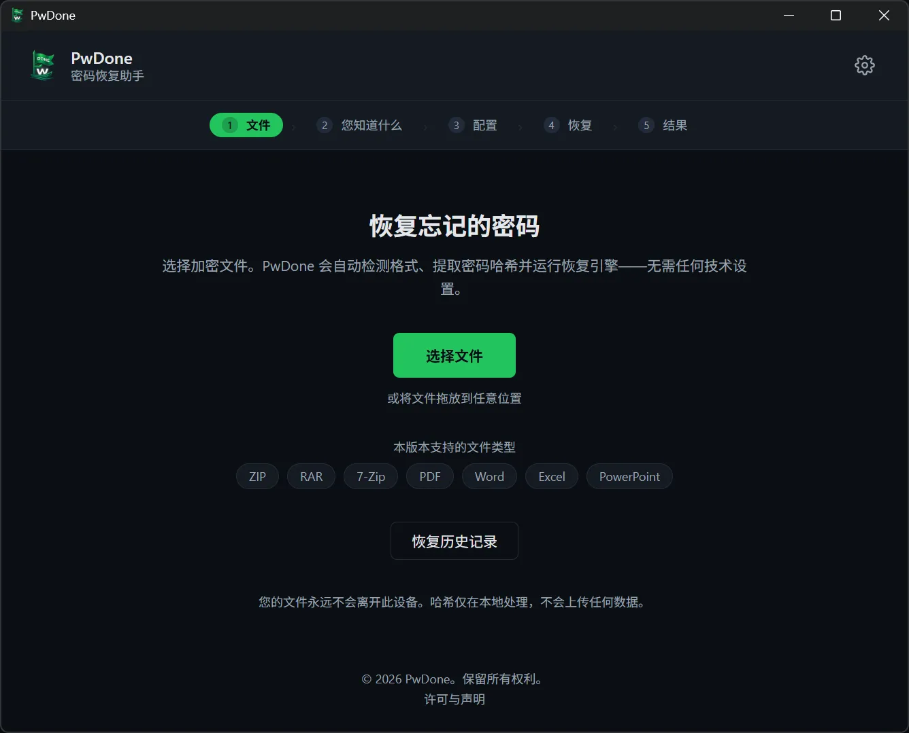
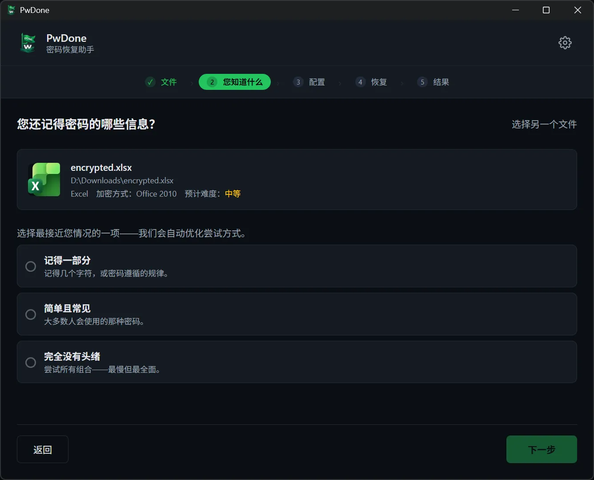
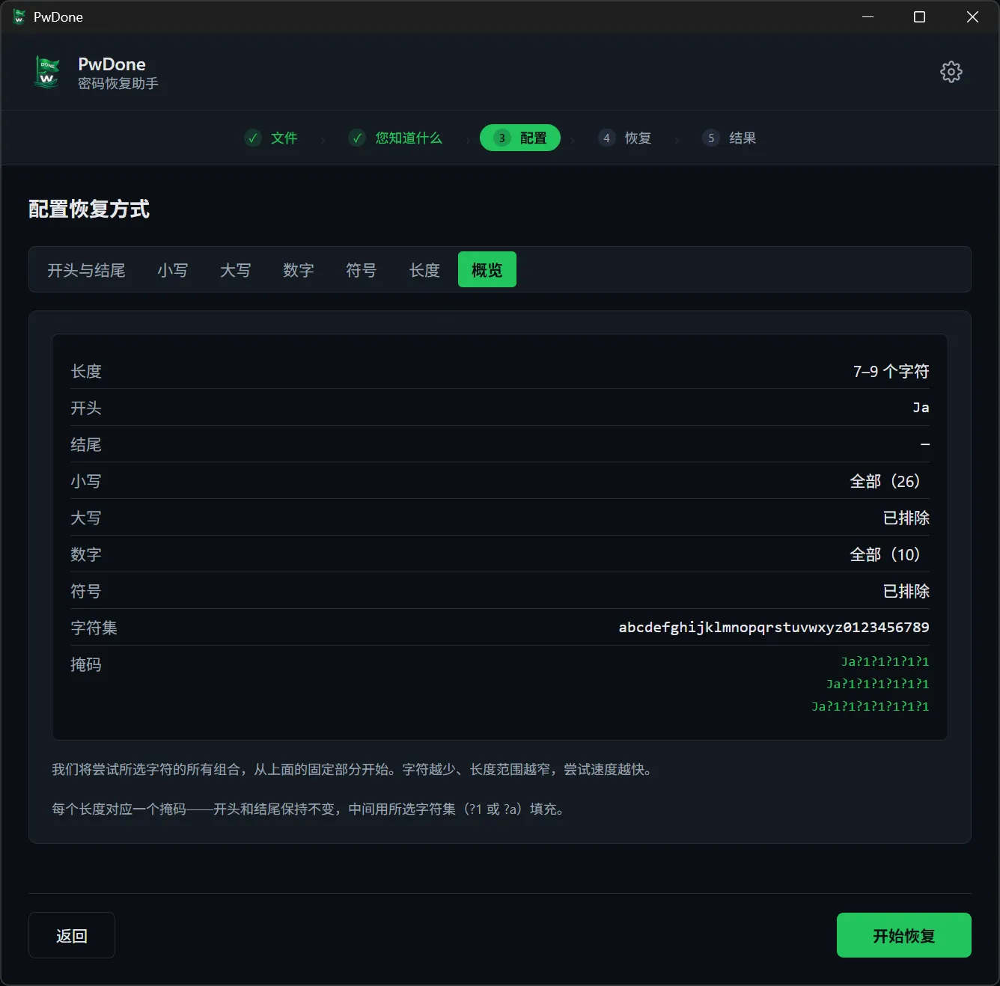
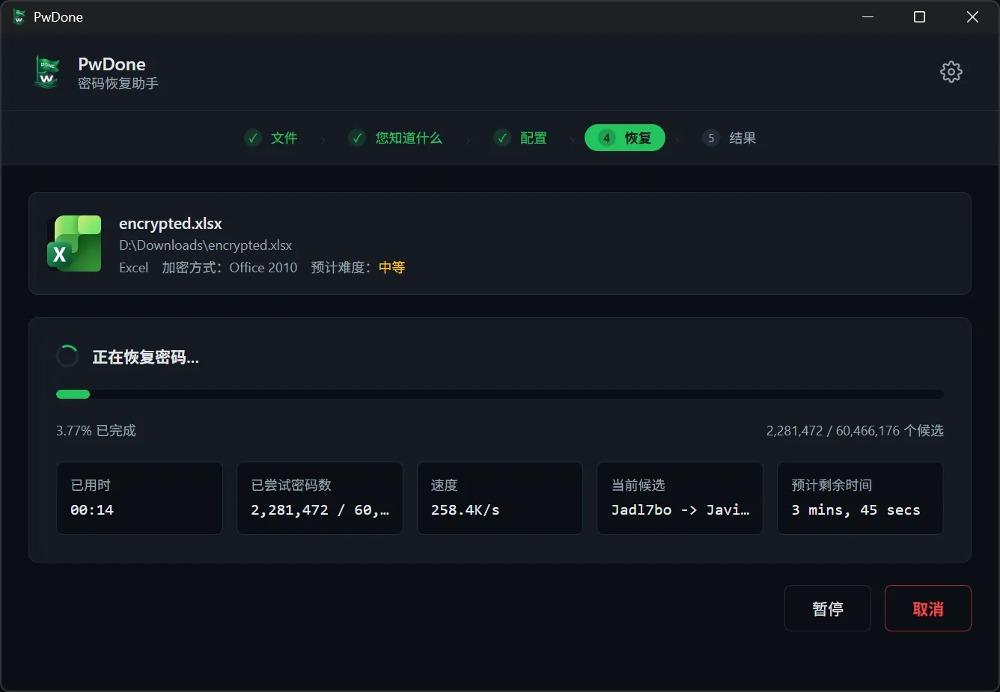
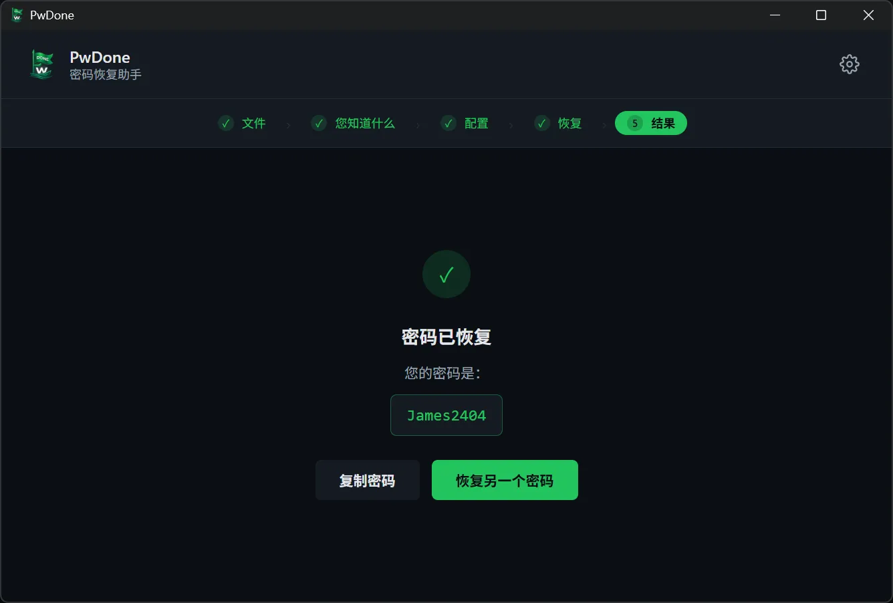

# PwDone

**本地优先的自有加密文件密码恢复工具。**

[English](README.md) · **简体中文** · [繁體中文](README.zh-Hant.md) · [日本語](README.ja.md) · [한국어](README.ko.md) · [Deutsch](README.de.md) · [Español](README.es.md) · [Français](README.fr.md) · [Italiano](README.it.md) · [Nederlands](README.nl.md) · [Polski](README.pl.md) · [Português](README.pt.md)

PwDone 帮助你恢复自己拥有的、受密码保护的 ZIP、RAR、7z、PDF、Word、Excel 和
PowerPoint 文件的访问权限。所有处理都在你的设备上完成：文件、哈希和恢复出的密码
都不会离开你的电脑。

[下载](https://pwdone.com/download) · [文档](https://pwdone.com/docs) · [价格](https://pwdone.com/pricing) · [对比](https://pwdone.com/alternatives) · [媒体资料](https://pwdone.com/press)

## 工作流程

**1. 文件** — 选择加密文件；PwDone 自动识别格式并在本机提取哈希。

**2. 您知道什么** — 告诉 PwDone 你对密码的了解：记得一部分、常见密码，或完全不知道。

**3. 配置** — 设置长度、要尝试的字符，或你记得的片段。

**4. 恢复** — 查看进度、速度和当前候选；可随时暂停或继续。

**5. 结果** — 复制恢复出的密码，或换一种方法再试。

## 功能

- 恢复你自己文件的密码：ZIP、RAR、7z、PDF、Word、Excel、PowerPoint。
- 自动检测文件格式，并在本机提取恢复哈希。
- 内置 Hashcat（GPU）与 John the Ripper（CPU），无需命令行。
- 全程本地处理，不上传文件、哈希或恢复出的密码。
- 本地保存恢复记录，重复尝试可立即得到结果。

## 支持格式

| 格式 | 扩展名 | 版本 |
| --- | --- | --- |
| ZIP | `.zip` | Archives |
| RAR | `.rar` | Archives |
| 7z | `.7z` | Archives |
| PDF | `.pdf` | PDF |
| Word | `.doc`, `.docx` | Office |
| Excel | `.xls`, `.xlsx` | Office |
| PowerPoint | `.ppt`, `.pptx` | Office |

## 隐私

- 100% 本地处理。
- 无需账号。
- 应用内无遥测、无使用追踪。
- 恢复记录仅保存在本机，可随时清除。

## 下载

- **Windows** 10/11（64 位）
- **macOS** 14+（Apple Silicon）

安装包与 SHA256 校验值：<https://pwdone.com/download>

> 如果 Windows SmartScreen 弹出警告，请查看下载页的图文说明
> （“更多信息” → “仍要运行”）。

完整说明见 [英文 README](README.md)。
